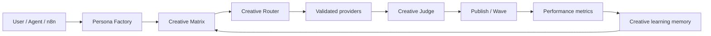

# ginkgo-pyre

IA de social media, calendário automático, copywriting e criação visual.

## Creative Runtime

Pyre exposes provider-neutral creative capabilities. Callers request semantic outcomes; the Creative Router resolves eligible validated providers and keeps provider/model/runtime details behind adapters.

Core references:

- [`docs/CREATIVE_ROUTER.md`](docs/CREATIVE_ROUTER.md) — provider-neutral image/runtime routing.
- [`docs/CREATIVE_RUNTIME_LIFECYCLE.md`](docs/CREATIVE_RUNTIME_LIFECYCLE.md) — creative job lifecycle.
- [`docs/PERSONA_FACTORY.md`](docs/PERSONA_FACTORY.md) — persistent AI personas, UGC, ads, identity consistency, product placement, multimodal generation and performance feedback.
- [`docs/CREATIVE_MATRIX.md`](docs/CREATIVE_MATRIX.md) — bounded batch experimentation, scoring, deduplication, budgets, early-stop and diversity-aware finalist selection.

## Direction

The strategic asset is the semantic workflow, persona memory and performance learning loop. Providers remain replaceable adapters.

## Status

- Creative Router: existing provider-neutral foundation.
- Persona Factory: **FEATURE / architecture proposal**.
- Creative Matrix: **FEATURE / architecture proposal**.

Implementation follows staged delivery: P0 contracts/persistence/routing/quality gates, P1 multimodal production and publishing handoff, P2 self-optimizing creative experiments and visual graph UX.
