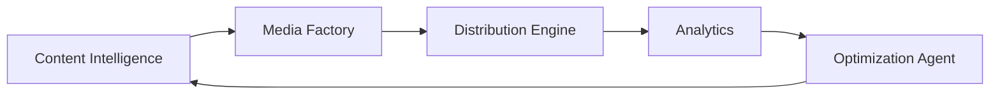

# Ginkgo Pyre

**AI-native Social Media Operations System**

Pyre é a camada da Ginkgo para pesquisa, criação, produção, distribuição e otimização contínua de conteúdo social.

O objetivo não é construir apenas um social scheduler. O produto trata cada publicação como um **experimento de atenção** conectado a hipótese, variante, execução, métricas e decisão seguinte.

```text
Research
  -> Create
  -> Render
  -> Schedule
  -> Publish
  -> Measure
  -> Learn
  -> Reallocate
```

## Visão de produto

Pyre combina quatro motores:

1. **Content Intelligence** — nichos, referências, hooks, scripts, hipóteses e planejamento.
2. **Media Factory** — ingestão, ASR/vision, edição, templates, FFmpeg/Remotion e render em lote.
3. **Distribution Engine** — calendário, scheduler, filas, publicação multi-plataforma, retries e reconciliação.
4. **Optimization Loop** — métricas, evidências, comparação de experimentos e autonomia limitada por políticas.



## Documentação

- [Dark Content Operations Architecture](docs/architecture/dark-content-operations.md)
- [SpeedPost Benchmark / Reverse Engineering Notes](docs/research/speedpost-benchmark.md)
- [Dark Content Operations Roadmap](docs/roadmap/dark-content-ops.md)

## Princípio central

O scheduler é uma commodity. O diferencial de Pyre deve ser o ciclo fechado:

```text
CONTENT OPERATIONS
       +
EXPERIMENTATION
       +
AGENTIC OPTIMIZATION
       =
PYRE
```

## Arquitetura alvo

Stack de referência inicial:

| Camada | Tecnologia candidata |
|---|---|
| Web | Next.js + TypeScript + shadcn/ui |
| API | FastAPI ou NestJS |
| Database | PostgreSQL |
| Queue | Redis + BullMQ |
| Media storage | S3 / Cloudflare R2 |
| Deterministic media | FFmpeg |
| Programmatic video | Remotion |
| Workflows | n8n |
| Social providers | Meta / TikTok / YouTube adapters |
| AI | provider-agnostic LLM adapters |
| Observability | OpenTelemetry |

A escolha final de runtime deve preservar contratos e adapters para impedir lock-in desnecessário.

## Lifecycle

Estado atual: `PROTOTYPE / ARCHITECTURE`

Ordem de evolução:

```text
execute reliably
-> observe completely
-> recommend safely
-> automate selectively
```

Autonomia sem observabilidade é apenas uma forma sofisticada de perder controle em escala.
