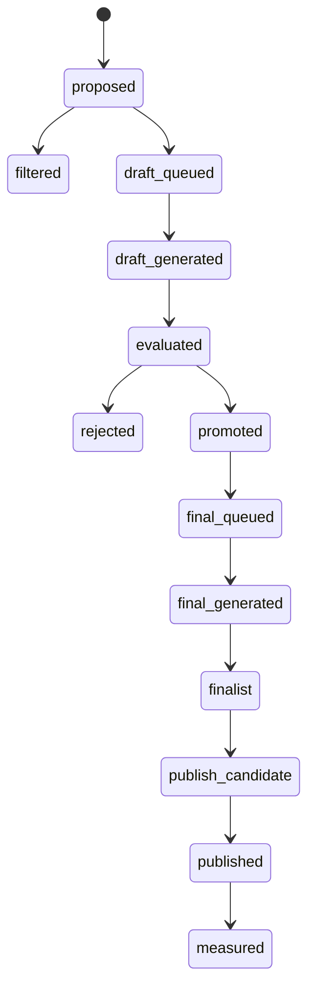

# Pyre Creative Matrix

Status: **FEATURE / architecture proposal**  
Parent: `docs/PERSONA_FACTORY.md`

## 1. Purpose

Creative Matrix converts a creative brief into a bounded experiment space, then progressively renders, scores and narrows candidates.

It is inspired by node/batch creative systems, but implemented as a provider-neutral domain capability.

The objective is not to render the cartesian product blindly. The objective is to explore enough of the space to find high-quality, commercially promising creatives within a defined cost/latency budget.

## 2. Mental model

```text
brief
  -> dimensions
  -> combinations
  -> prefilter
  -> draft generation
  -> evaluation
  -> finalist generation
  -> optional video/audio
  -> publish candidates
  -> performance feedback
```

Example dimensions:

```yaml
persona:
  - lara

product:
  - perfume
  - watch
  - glasses

scene:
  - beach
  - rooftop
  - apartment

style:
  - luxury
  - ugc
  - cinematic

camera:
  - close
  - medium
  - full_body
```

The theoretical space above contains 81 combinations. A policy may choose to render only 20 drafts, promote 8 images, then generate 4 videos and 2 publish candidates.

## 3. Contract

```ts
type MatrixDimensionValue = {
  id: string
  label?: string
  prompt_fragment?: string
  metadata?: Record<string, string | number | boolean>
  weight?: number
}

interface CreativeMatrixRequest {
  request_id: string
  matrix_id?: string
  objective: 'social' | 'ugc' | 'ad' | 'product-demo' | 'editorial'

  persona_id?: string
  base_prompt?: string
  reference_asset_ids?: string[]

  dimensions: Record<string, MatrixDimensionValue[]>

  policy: {
    max_combinations: number
    draft_candidates: number
    finalists: number
    publish_candidates?: number
    max_cost_usd?: number
    max_wall_time_ms?: number
    seed_strategy?: 'fixed' | 'derived' | 'random'
    diversity?: 'low' | 'medium' | 'high'
  }

  evaluation?: {
    quality_min?: number
    identity_min?: number
    brand_min?: number
    product_fidelity_min?: number
    novelty_min?: number
  }

  metadata?: {
    campaign_id?: string
    product_id?: string
    channel?: string
    caller?: string
    tags?: string[]
  }
}
```

## 4. Combination identity

Every candidate gets a deterministic semantic fingerprint derived from:

- matrix ID;
- dimension keys and values;
- persona ID;
- reference asset IDs;
- normalized base prompt;
- generation stage;
- seed strategy.

This fingerprint supports:

- idempotency;
- duplicate suppression;
- auditability;
- performance attribution;
- replay.

Provider/model identifiers are excluded from the semantic fingerprint because provider choice is a Router decision.

## 5. Expansion algorithm

### Phase A — enumerate or sample

If total combinations <= `max_combinations`, enumerate all.

If total combinations > `max_combinations`, use weighted stratified sampling so every relevant dimension receives coverage.

Do not take the first N cartesian items because that creates ordering bias.

### Phase B — semantic prefilter

Before generation, reject combinations that violate:

- brand rules;
- product constraints;
- persona constraints;
- duplicated semantics;
- channel limitations;
- forbidden claims;
- incompatible dimension pairs.

### Phase C — cheap draft

Generate lower-cost/lower-latency candidates where policy allows.

Examples:

- lower resolution;
- fewer diffusion steps;
- cheaper cloud tier;
- image before video;
- still-frame storyboard before full animation.

### Phase D — score

Score every draft using a normalized evaluation envelope.

```ts
interface CreativeEvaluation {
  asset_id: string
  matrix_candidate_id: string

  scores: {
    quality: number
    identity?: number
    prompt_adherence: number
    brand?: number
    product_fidelity?: number
    novelty?: number
    composition?: number
    text_legibility?: number
  }

  hard_failures: string[]
  notes?: string[]
  total_score: number
  eligible: boolean
}
```

### Phase E — promote

Promote only candidates that:

1. pass all hard thresholds;
2. are not near-duplicates of a higher-scoring candidate;
3. maintain portfolio diversity;
4. fit the remaining budget.

### Phase F — expensive final

Apply high-quality image/video/audio/lip-sync only to promoted candidates.

## 6. Ranking policy

A single weighted score is insufficient because it can produce 10 almost-identical winners.

Use two stages:

### Eligibility

```text
eligible = no_hard_failures
        AND quality >= quality_min
        AND identity >= identity_min (if persona)
        AND brand >= brand_min (if brand rules exist)
        AND product_fidelity >= product_fidelity_min (if product reference exists)
```

### Portfolio selection

Select finalists with a diversity-aware objective:

```text
portfolio_score = creative_score
                - duplicate_penalty
                + dimension_coverage_bonus
                + novelty_bonus
```

This avoids an army of clones winning because one prompt pattern was slightly favored by the judge.

## 7. Early stop

A matrix can terminate before consuming the entire budget when:

- required number of finalists already passes a high-confidence threshold;
- remaining candidates are statistically redundant;
- budget is nearly exhausted;
- provider health degrades;
- campaign policy changes/cancels execution.

Example:

```text
required finalists = 8
high-confidence threshold = 0.91

if 8 diverse candidates >= 0.91:
    stop draft expansion
```

## 8. Budget ledger

Every matrix execution maintains:

```ts
interface MatrixBudgetLedger {
  matrix_id: string
  budget_usd?: number
  estimated_committed_usd: number
  actual_billed_usd: number
  jobs_submitted: number
  jobs_completed: number
  jobs_failed: number
  jobs_rejected: number
  jobs_promoted: number
}
```

A new paid job may only be submitted when:

```text
actual_billed + estimated_committed + estimated_next_job <= budget
```

Fail closed if cost cannot be estimated for a provider while a hard budget is active.

## 9. Candidate lifecycle



## 10. Failure semantics

Do not conflate:

- `filtered`: invalid combination before generation;
- `failed`: provider/runtime execution failed;
- `rejected`: generation succeeded but quality/identity/policy failed;
- `budget_blocked`: candidate was valid but execution would exceed budget;
- `deduplicated`: candidate lost to a semantically/visually similar stronger candidate.

These distinctions are necessary for learning.

## 11. Creative Judge

Judge implementation should be pluggable and evidence-producing.

Possible evaluators:

- deterministic rules;
- image similarity model;
- multimodal LLM/VLM;
- OCR/text checks;
- logo/product similarity;
- face consistency model;
- brand policy engine;
- human review.

The Judge returns normalized scores and evidence. It does not choose a generation provider.

## 12. Human approval

Matrix policy can define gates:

```text
none
finalists_only
before_publish
before_paid_media
```

Paid media should default to an approval gate until the campaign execution layer has separately validated autonomous publishing/spend controls.

## 13. Performance feedback

After publish, ingest downstream metrics keyed by `asset_id` and `matrix_candidate_id`.

The system can then calculate dimension priors:

```text
P(high_CTR | style=ugc, camera=close, scene=apartment)
P(high_ROAS | persona=lara, hook=problem_solution)
P(high_completion | duration=12s, voice=energetic)
```

These priors influence future sampling weights but must not become permanent rules. Keep exploration alive.

## 14. Experiment policy

Future optimization can use a contextual bandit:

```text
context = channel + product + audience + persona + objective
arms = creative dimension combinations
reward = weighted business outcome
```

Candidate reward should prioritize business metrics over aesthetic scores when sufficient real-world evidence exists.

Aesthetic Judge = preflight.
Market result = truth signal.

## 15. Storage model

Suggested entities:

```text
creative_matrices
creative_matrix_dimensions
creative_matrix_candidates
creative_evaluations
creative_assets
creative_performance
creative_learning_priors
```

Minimum candidate fields:

```text
candidate_id
matrix_id
semantic_fingerprint
dimensions_json
stage
status
asset_id
estimated_cost_usd
actual_cost_usd
score
failure_reason
created_at
updated_at
```

## 16. Observability

Matrix dashboard should expose:

- theoretical combinations;
- sampled combinations;
- filtered combinations;
- generated drafts;
- finalists;
- total cost;
- cost/finalist;
- mean evaluation score;
- provider failure rate;
- identity failure rate;
- duplicate rate;
- time to first finalist;
- time to matrix completion.

## 17. P0 implementation plan

### Contracts

- [ ] add `CreativeMatrixRequest` contract;
- [ ] add candidate/evaluation/result contracts;
- [ ] establish idempotent semantic fingerprint;
- [ ] establish normalized statuses/failure reasons.

### Engine

- [ ] deterministic expansion;
- [ ] weighted sampling when over limit;
- [ ] hard `max_combinations`;
- [ ] hard `draft_candidates`;
- [ ] hard `finalists`;
- [ ] budget ledger;
- [ ] early stop;
- [ ] dedup interface;
- [ ] Judge interface.

### Integration

- [ ] submit generation jobs through Creative Router only;
- [ ] propagate campaign/persona metadata;
- [ ] normalize provider failures;
- [ ] persist candidate -> asset linkage.

### Tests

- [ ] cartesian expansion <= limit;
- [ ] sampled expansion > limit;
- [ ] deterministic fingerprint;
- [ ] no duplicate paid submission for same candidate;
- [ ] hard budget never exceeded by committed jobs;
- [ ] failed provider job does not become a quality rejection;
- [ ] diversity-aware finalist selection;
- [ ] early-stop behavior;
- [ ] generic callers cannot force provider/model.

## 18. Example

Input:

```json
{
  "request_id": "req-123",
  "objective": "ad",
  "persona_id": "lara",
  "dimensions": {
    "product": [
      {"id": "perfume"},
      {"id": "watch"},
      {"id": "glasses"}
    ],
    "scene": [
      {"id": "beach"},
      {"id": "rooftop"},
      {"id": "apartment"}
    ],
    "style": [
      {"id": "luxury"},
      {"id": "ugc"},
      {"id": "cinematic"}
    ],
    "camera": [
      {"id": "close"},
      {"id": "medium"},
      {"id": "full_body"}
    ]
  },
  "policy": {
    "max_combinations": 81,
    "draft_candidates": 20,
    "finalists": 8,
    "publish_candidates": 2,
    "max_cost_usd": 10,
    "diversity": "high"
  }
}
```

Expected behavior:

```text
81 theoretical combinations
 -> prefilter/sampling
 -> <=20 draft jobs
 -> score + dedup
 -> <=8 finalists
 -> optional expensive rendering
 -> <=2 publish candidates
 -> performance feedback after publication
```

## 19. Design rule

Creative Matrix is **not** a provider workflow language.

It describes what creative experiment Pyre wants to run. The Creative Router decides how eligible semantic tasks are executed.