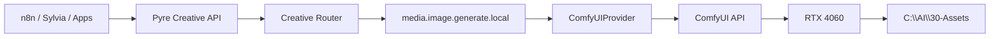

# Pyre Creative Router — provider-neutral (Wave 7)

Transforma o runtime criativo validado (ComfyUI on-demand do ai-stack, Waves 5/6) em uma
**capacidade consumível** por agentes, n8n, Sylvia e aplicações — sem que nenhum caller
conheça ComfyUI, node IDs, workflows, checkpoints, porta 8188 ou Docker.



## Ownership

| Camada | Dono |
|---|---|
| Runtime ComfyUI (container, GPU) | **ai-stack** (Ginkgo-Core/ai-stack, profile `creative`) |
| Creative Router + adapters + contratos | **Pyre** (este repo, `backend/src/modules/creative/`) |
| Orquestração/caller | **n8n** |
| Seleção de skill/capability | **Sylvia** |
| Storage físico dos assets | `C:\AI\30-Assets` (nunca no Git; nenhum model weight no Pyre) |

## Arsenal contract

| Conceito | Valor |
|---|---|
| CAPABILITY | `creative.image.local` |
| SKILL | `media.image.generate.local` |
| TOOL | `comfyui-local` |
| PROVIDER | `local` |
| OUTPUT CONTRACT | `creative-asset` (CreativeGenerationResult) |

Futuros (contratos preparados, sem provider real): `creative.image.cloud`, `creative.video.cloud`
(fal.ai, Higgsfield, Google) — implementar `CreativeProvider` e registrar no Router; callers não mudam.

## API

| Rota | Função |
|---|---|
| `POST /v1/creative/jobs` | Submete `CreativeGenerationRequest`; retorna `202` com `job_id` (nunca o prompt_id interno do provider) |
| `GET /v1/creative/jobs/{job_id}` | Resultado normalizado (`queued`/`running`/`completed`/`failed`) |
| `GET /v1/creative/providers/health` | Saúde REAL dos providers (ComfyUI: `/system_stats`) |

### Request (mínimo)

```json
{
  "request_id": "uuid-do-caller",
  "capability": "creative.image.local",
  "skill": "media.image.generate.local",
  "kind": "image",
  "prompt": "…",
  "negative_prompt": "…",
  "seed": 12345,
  "preset": "sdxl-local-standard",
  "metadata": { "caller": "n8n", "campaign_id": "…", "tags": ["…"] }
}
```

`width`/`height` opcionais: 256–1024, múltiplos de 8 (limite desta wave). Preset padrão
`sdxl-local-standard` = 768×768, steps 20, cfg 6.5, euler/normal (conservador para 8 GB de VRAM).

### Result (completed)

`provider{id,tool,model}`, `asset{id,path,mime_type,width,height,bytes}`,
`generation{seed,duration_ms,workflow,prompt_hash}`, `cost{billing_cost_usd: 0, compute_cost_estimate: null}`
(local não é "custo zero" — a estimativa de computação fica explícita como não calculada),
`provenance{created_at,provider_version,model_sha256}`.

### Erros normalizados

`PROVIDER_UNAVAILABLE` · `PROVIDER_UNHEALTHY` · `INVALID_REQUEST` · `UNSUPPORTED_CAPABILITY` ·
`GENERATION_FAILED` · `TIMEOUT` · `ASSET_NOT_FOUND` — sempre `{code, message, retryable}`;
tracebacks ficam nos logs internos, nunca no caller.

## Config (env — ver `backend/.env.example`)

`COMFYUI_BASE_URL` (default `http://127.0.0.1:8188`, correto para Pyre no host; ajustar se
containerizado), `COMFYUI_DEFAULT_MODEL`, `COMFYUI_OUTPUT_ROOT`. Sem credenciais hard-coded.

## Storage e metadata

Assets em `C:\AI\30-Assets\images\generated\pyre\` (subpasta própria do Router). Cada geração
grava sidecar `<imagem>.pyre.json` (request_id, job_id, capability, skill, provider, tool,
model+sha256, prompt/negative, seed, preset, resolução, duração, created_at) — nunca sobrescreve
sidecars existentes de outras origens.

## Job mapping (MVP)

`job_id` (Pyre, UUID) ↔ `prompt_id` (ComfyUI) mantido **in-memory** no adapter — MVP documentado:
jobs não sobrevivem a restart do backend. Persistência entra quando houver banco no fluxo (fora
desta wave).

## Exemplo de caller n8n (handoff)

Nó **HTTP Request** do n8n → Pyre (NUNCA direto no ComfyUI):

```json
{
  "method": "POST",
  "url": "http://127.0.0.1:3000/v1/creative/jobs",
  "headers": { "content-type": "application/json" },
  "body": {
    "request_id": "={{ $execution.id }}",
    "capability": "creative.image.local",
    "skill": "media.image.generate.local",
    "kind": "image",
    "prompt": "={{ $json.prompt }}",
    "negative_prompt": "low quality, blurry, malformed, text, watermark",
    "preset": "sdxl-local-standard",
    "metadata": { "caller": "n8n", "campaign_id": "={{ $json.campaign_id }}" }
  }
}
```

Depois, polling em `GET /v1/creative/jobs/{{job_id}}` até `status=completed` e uso de `asset.path`.

## Testes

`npm test` (backend/) — unitários sem GPU: validação, capability não suportada, seleção de
provider, erros normalizados, contrato de resultado, health routing. Smoke de integração real
(GPU): subir ComfyUI (`ai-stack/scripts/creative-up.ps1`) + `npm run dev` e usar os exemplos acima.
