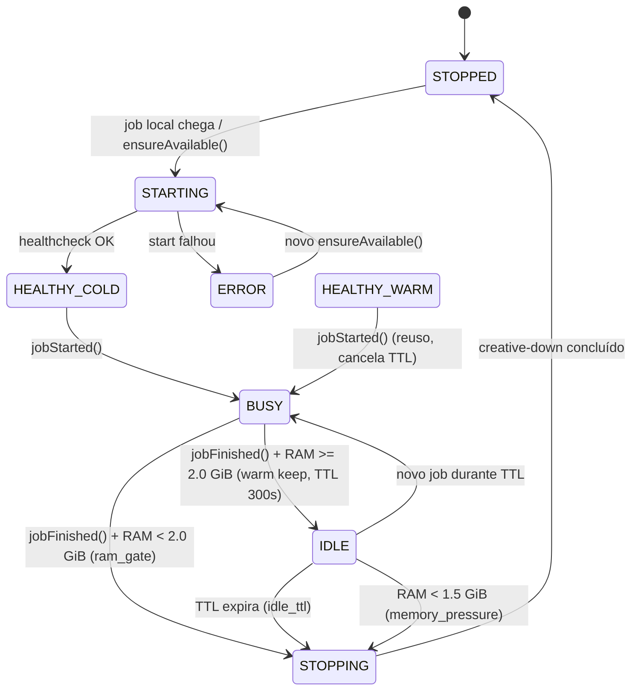

# Creative Runtime Lifecycle (Wave 9)

Lifecycle on-demand do runtime local (ComfyUI/ai-stack), gerenciado pelo
`CreativeRuntimeManager` (`backend/src/modules/creative/runtime/`). O manager vive no
Pyre (camada operacional no host) — nunca no workflow n8n, nunca na Sylvia.

## State machine

Invariantes: **nunca** desligar em BUSY; start é **single-flight** (N jobs concorrentes com
runtime parado → 1 único start, todos aguardam o mesmo health).

## Política (evidência da Wave 8/9)

| Parâmetro | Valor produção | Base |
|---|---|---|
| `CREATIVE_MIN_FREE_RAM_GIB` | 2.0 | warm idle medido deixou ~1,2 GiB livres — sem margem |
| `CREATIVE_IDLE_TTL_SECONDS` | 300 | warm = 6× mais rápido (10,1s vs 61,2s) — vale manter quando a RAM permite |
| `CREATIVE_MEMORY_FLOOR_GIB` | 1.5 | guarda durante o TTL; desliga IDLE sob pressão |

`RUNTIME_SHUTDOWN_REASON` ∈ `idle_ttl` · `memory_pressure` · `ram_gate` · `manual` · `error` · `maintenance` (logado estruturado).

## Segurança (allowlist)

O manager executa SOMENTE três scripts fixos (paths via env, nunca de request):
`docker-start-safe.ps1` → `creative-up.ps1` → (shutdown) `creative-down.ps1`.
Nenhum campo `command/args/path/script` é aceito de callers.

## Persistência e restart

Jobs vivem em `pyre.creative_jobs` (Postgres — localmente o Postgres do ai-stack; em produção
o Postgres do Supabase). No boot o Router **reconcilia** jobs em voo: provider alcançável →
adota estado real; senão → `failed` com `PROVIDER_STATE_LOST` (retryable) — sem re-execução
automática, sem geração duplicada. `request_id` é chave de idempotência (payload igual →
replay do job; conflitante → `IDEMPOTENCY_CONFLICT` 409).
