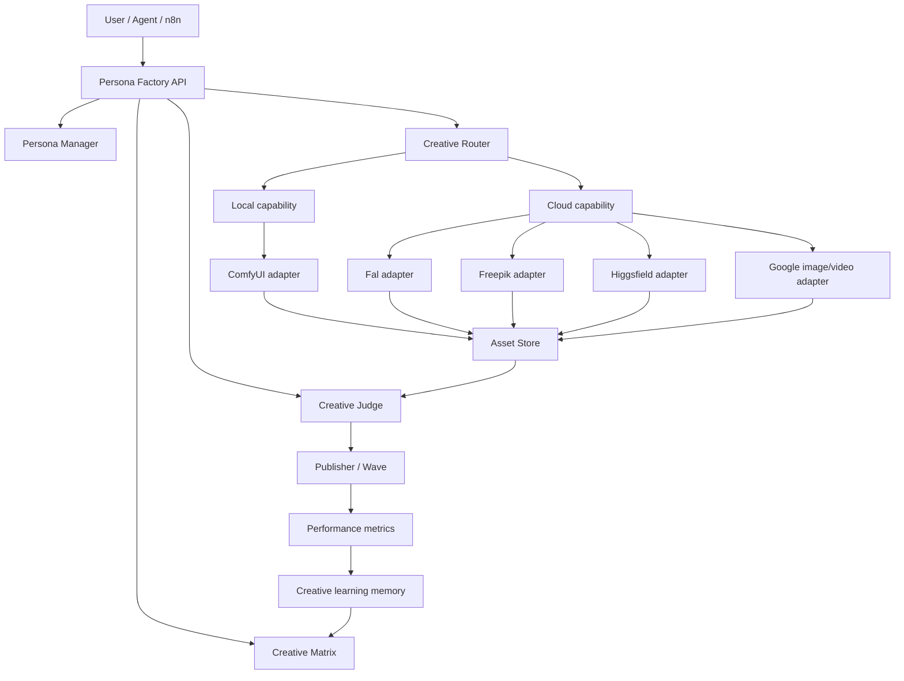
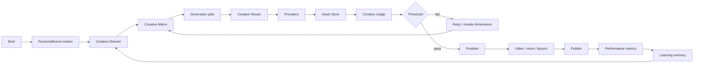
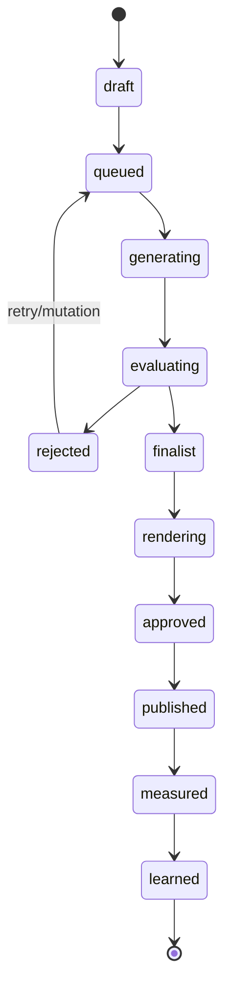

# Pyre Persona Factory

Status: **FEATURE / architecture proposal**  
Owner: **Pyre**  
Depends on: Creative Router, provider adapters, asset storage, n8n/Sylvia callers  
Principle: **product semantics above provider semantics**

## 1. Objective

Persona Factory turns Pyre's provider-neutral creative runtime into a vertical product for persistent AI personas, UGC, ads and social content.

The user/caller asks for outcomes such as:

- create a persona;
- keep face/body/style consistent;
- place a persona in a scene;
- place a product in the scene;
- change outfit/background/expression/pose;
- create voice and lip-sync;
- animate image to video;
- generate many creative variants;
- select the best variants;
- publish and learn from campaign performance.

The caller must **not** choose ComfyUI, Fal, Freepik, Higgsfield, model names, checkpoint paths, node IDs or execution commands. Provider choice remains a Creative Router policy decision.

## 2. Product thesis

Benchmark patterns:

- **Persona Builder:** strong vertical abstraction. The user sees actions such as "create influencer", not the underlying model stack.
- **Freepik Spaces:** strong graph/batch abstraction. A generated list can fan out into many generation branches.
- **Pyre:** should combine both patterns while preserving provider neutrality and local/cloud portability.

Target architecture:



Provider nodes above are **targets**, not claims that every adapter is currently implemented or validated.

## 3. Ownership boundaries

| Concern | Owner |
|---|---|
| Persona domain model | Pyre |
| Persona Factory orchestration | Pyre |
| Creative Matrix expansion | Pyre |
| Creative scoring/selection | Pyre |
| Provider routing | Pyre Creative Router |
| ComfyUI runtime/GPU | ai-stack |
| Workflow caller/orchestration | n8n / Sylvia |
| Paid-media execution | Wave |
| Physical generated assets | configured asset store |
| Provider credentials | secrets provider / runtime environment |

### Hard boundary

Persona Factory can express semantic constraints such as:

- `identity_consistency=high`
- `privacy=local_only`
- `latency=batch`
- `quality=premium`
- `max_cost_usd=...`

It must not send:

- provider IDs;
- model IDs;
- workflow filenames;
- shell commands;
- container paths;
- arbitrary ComfyUI node graphs.

## 4. Domain model

### 4.1 Persona

```ts
interface PersonaProfile {
  persona_id: string
  name: string
  status: 'draft' | 'active' | 'archived'

  identity: {
    description: string
    reference_asset_ids: string[]
    face_lock?: 'relaxed' | 'balanced' | 'strict'
    body_lock?: 'relaxed' | 'balanced' | 'strict'
  }

  visual_style?: {
    age_range?: string
    hair?: string
    wardrobe?: string[]
    aesthetic?: string[]
    prohibited_traits?: string[]
  }

  voice?: {
    voice_profile_id?: string
    language?: string
    accent?: string
    tone?: string
  }

  behavior?: {
    personality?: string[]
    brand_voice?: string[]
    forbidden_topics?: string[]
  }

  provenance: {
    created_at: string
    updated_at: string
    reference_consent_record?: string
  }
}
```

### 4.2 Scene intent

```ts
interface PersonaSceneRequest {
  request_id: string
  persona_id: string
  objective: 'social' | 'ugc' | 'ad' | 'product-demo' | 'editorial'

  scene?: string
  product_asset_ids?: string[]
  wardrobe?: string
  pose?: string
  expression?: string
  camera?: string
  aspect_ratio?: string

  output: {
    kind: 'image' | 'video' | 'audio' | 'multimodal'
    variants?: number
  }

  constraints?: {
    privacy?: 'local_only' | 'cloud_allowed'
    quality?: 'draft' | 'standard' | 'high' | 'premium'
    latency?: 'interactive' | 'normal' | 'batch'
    max_cost_usd?: number
    identity_consistency?: 'normal' | 'high' | 'strict'
  }

  metadata?: {
    campaign_id?: string
    product_id?: string
    channel?: string
    caller?: string
    tags?: string[]
  }
}
```

## 5. Capabilities and skills

Proposed semantic capabilities:

| Capability | Generic skill | Purpose |
|---|---|---|
| `creative.persona.create` | `persona.create` | establish persistent persona profile |
| `creative.persona.image` | `persona.image.generate` | generate persona image |
| `creative.persona.edit` | `persona.image.edit` | outfit/background/expression/product edit |
| `creative.persona.video` | `persona.video.generate` | image/text/reference to video |
| `creative.persona.voice` | `persona.voice.generate` | voice/TTS output |
| `creative.persona.lipsync` | `persona.lipsync.generate` | align face/mouth to audio |
| `creative.matrix.expand` | `creative.variants.expand` | generate structured creative combinations |
| `creative.judge.score` | `creative.asset.score` | score candidates |
| `creative.judge.select` | `creative.asset.select` | choose finalists |

These capabilities should route through generic domain contracts. Provider-specific capabilities remain implementation details behind the Router.

## 6. Character consistency strategy

Identity consistency is a product requirement, not a specific-model requirement.

The Router may satisfy it using different mechanisms depending on validated provider support:

- reference-image conditioning;
- face embeddings;
- IP-Adapter-style conditioning;
- LoRA/character adapter;
- provider-native character/reference features;
- image editing with locked reference assets.

The persistence layer should store **references and identity metadata**, not provider-internal node IDs.

### Consistency validation

Every generated asset for a strict persona should receive at least:

- face similarity score;
- visual artifact score;
- prompt/scene adherence score;
- product fidelity score when a product reference exists;
- policy/brand check;
- duplicate/near-duplicate detection.

Assets below threshold are rejected before publish.

## 7. Creative pipeline



## 8. Product-placement mode

Persona Factory must support UGC/product creative without requiring a bespoke workflow per product.

Inputs:

- persona reference;
- product reference assets;
- product metadata;
- usage context;
- claims allowed/prohibited;
- visual constraints.

Required checks:

1. product logo/shape preservation;
2. no invented product claims;
3. no accidental replacement with a lookalike product;
4. clear provenance of reference assets;
5. publish gate for regulated or high-risk categories.

## 9. Asset and provenance contract

Every output should maintain:

```json
{
  "asset_id": "...",
  "persona_id": "...",
  "request_id": "...",
  "campaign_id": "...",
  "parent_asset_ids": [],
  "prompt_hash": "...",
  "provider": "resolved-by-router",
  "model": "resolved-by-router",
  "generation_time_ms": 0,
  "billing_cost_usd": 0,
  "created_at": "...",
  "consistency_score": 0,
  "quality_score": 0,
  "brand_score": 0,
  "selected": false
}
```

The API presented to callers should expose normalized provenance; internal provider payloads stay private.

## 10. API proposal

### Persona lifecycle

```text
POST   /v1/personas
GET    /v1/personas/{persona_id}
PATCH  /v1/personas/{persona_id}
POST   /v1/personas/{persona_id}/references
POST   /v1/personas/{persona_id}/archive
```

### Generation

```text
POST   /v1/personas/{persona_id}/jobs
GET    /v1/personas/jobs/{job_id}
```

### Creative Matrix

```text
POST   /v1/creative/matrices
GET    /v1/creative/matrices/{matrix_id}
POST   /v1/creative/matrices/{matrix_id}/execute
GET    /v1/creative/matrices/{matrix_id}/results
```

### Evaluation

```text
POST   /v1/creative/evaluations
GET    /v1/creative/evaluations/{evaluation_id}
```

## 11. State machine



A failed provider execution and a rejected creative are different states:

- **failed:** infrastructure/model execution failure;
- **rejected:** generation completed but did not meet quality/identity/brand threshold.

## 12. Provider policy

Provider routing should optimize a weighted policy rather than a hard-coded preference.

Example dimensions:

```text
eligibility = validated
            AND supports(kind)
            AND satisfies(privacy)
            AND satisfies(identity_consistency)
            AND estimated_cost <= budget

score = quality_weight * quality
      + latency_weight * latency
      + cost_weight * cost_efficiency
      + consistency_weight * identity_support
      + reliability_weight * recent_success_rate
```

### Fallback

Fallback must remain `none` or `same_semantics_only`.

Examples:

- local image generation may fall back to another validated image provider only when privacy allows cloud;
- image generation must not silently fall back to video or a semantically different task;
- strict identity workflows must not fall back to providers that cannot satisfy strict identity semantics.

## 13. Cost controls

Batch generation can amplify spend quickly. Required controls:

- request-level `max_cost_usd`;
- matrix-level budget;
- per-provider cost estimator;
- maximum candidate count;
- early-stop when enough finalists pass threshold;
- dedup before expensive video generation;
- staged quality: cheap draft -> judge -> expensive final;
- daily/workspace budget guardrails.

Recommended pattern:

```text
81 concepts
  -> text/rule prefilter
  -> 20 draft images
  -> visual judge
  -> 8 high-quality images
  -> 4 videos
  -> 2 publish candidates
```

Do not render all permutations at maximum quality by default.

## 14. Creative learning loop

The differentiator is not generation volume. It is closed-loop learning.

Performance record:

```ts
interface CreativePerformance {
  asset_id: string
  campaign_id: string
  channel: 'meta' | 'instagram' | 'tiktok' | 'youtube' | 'other'
  impressions?: number
  clicks?: number
  ctr?: number
  spend?: number
  cpc?: number
  conversions?: number
  cpa?: number
  revenue?: number
  roas?: number
  watch_time?: number
  completion_rate?: number
}
```

The learning layer should correlate performance with creative dimensions such as:

- persona;
- hook;
- scene;
- product;
- camera;
- style;
- CTA;
- duration;
- voice;
- caption;
- channel.

Outputs become priors for the next Creative Matrix instead of being used to blindly retrain a model.

## 15. Safety, consent and provenance

Required controls before production:

- reference asset provenance;
- explicit consent record for real-person likenesses;
- blocklist for impersonation-sensitive personas;
- watermark/provenance policy where applicable;
- audit log of persona edits and generations;
- prompt/output moderation;
- age/identity constraints;
- human approval gate for high-risk campaigns;
- deletion path for persona references and derived assets.

No real-person face should become a reusable persona without a consent/provenance record.

## 16. Observability

Per job/matrix collect:

- total wall time;
- queue time;
- provider latency;
- provider error code;
- retries;
- generated candidates;
- rejected candidates and reasons;
- selected candidates;
- cost estimate vs actual billing cost;
- identity/quality/brand scores;
- downstream campaign metrics when available.

Required dashboards:

1. provider reliability;
2. creative cost per finalist;
3. persona consistency;
4. candidate-to-finalist conversion;
5. finalist-to-published conversion;
6. campaign performance by creative dimension.

## 17. MVP scope

### P0 — foundation

- [ ] canonical `PersonaProfile` contract;
- [ ] persona persistence;
- [ ] persona CRUD API;
- [ ] reference-asset registry;
- [ ] `persona.image.generate` semantic request;
- [ ] identity-consistency constraint in routing policy;
- [ ] normalized persona asset metadata;
- [ ] basic quality/consistency evaluation interface;
- [ ] Creative Matrix contract;
- [ ] budget/candidate hard limits;
- [ ] unit and contract tests;
- [ ] no provider-specific fields accepted from callers.

### P1 — production creative

- [ ] image edit/outfit/background/product placement;
- [ ] video capability;
- [ ] voice capability;
- [ ] lip-sync capability;
- [ ] automated Creative Judge;
- [ ] matrix early-stop;
- [ ] campaign metadata propagation;
- [ ] Wave handoff for publishing/ads;
- [ ] performance ingestion.

### P2 — self-optimizing creative system

- [ ] creative priors from historical performance;
- [ ] multi-armed-bandit/experiment allocation;
- [ ] provider scoring using observed reliability/cost/quality;
- [ ] automated variant mutation from failure reasons;
- [ ] persona/brand knowledge memory;
- [ ] visual graph editor inspired by node-based creative tools;
- [ ] reusable graph templates;
- [ ] workspace/team collaboration.

## 18. Acceptance criteria for P0

P0 is complete only when:

1. a caller can create a persona using provider-neutral fields;
2. a caller can request an image for that persona without naming a provider/model;
3. a persisted reference set can be resolved internally;
4. Router selects only a validated eligible provider;
5. strict/local constraints fail closed when no provider qualifies;
6. result contains normalized provenance and cost metadata;
7. generated asset receives consistency + quality evaluation;
8. matrix execution obeys candidate and budget limits;
9. idempotent request IDs do not produce duplicate paid jobs;
10. tests prove provider-specific fields are rejected at the public boundary.

## 19. Non-goals

For the first implementation:

- building a proprietary foundation image/video model;
- exposing raw ComfyUI workflows to callers;
- cloning Persona Builder UI pixel-for-pixel;
- cloning Freepik Spaces;
- training character LoRAs automatically without approval;
- publishing without explicit campaign policy;
- optimizing only for generation volume.

## 20. Strategic result

Persona Factory should make Pyre feel simple at the product layer while remaining sophisticated under the hood:

```text
User intent
   -> Persona Factory
   -> Creative Matrix
   -> Creative Router
   -> best validated provider
   -> Creative Judge
   -> publish
   -> performance
   -> learning memory
```

The stable asset is the **semantic workflow + persona memory + performance feedback loop**. Providers remain replaceable adapters.