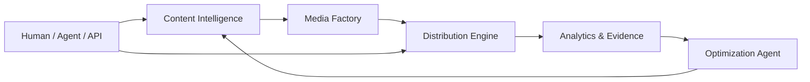
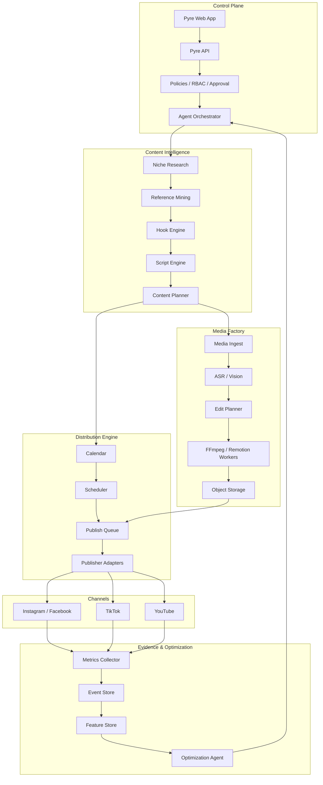
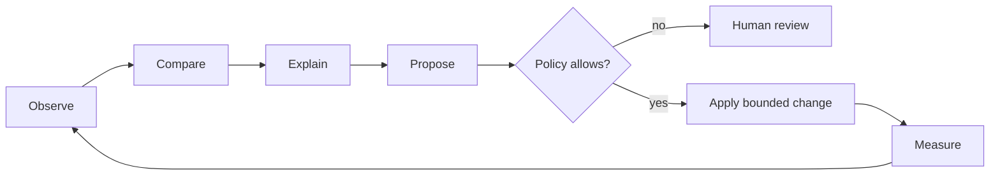

# Pyre — Dark Content Operations Architecture

## Status

- Lifecycle: `PROTOTYPE`
- Scope: arquitetura de produto e execução
- Owner lógico: Pyre
- Objetivo: transformar produção e distribuição de conteúdo social em um sistema operacional orientado por agentes, filas, evidências e otimização contínua.

## 1. Visão

Pyre não deve ser apenas um agendador de posts. A referência analisada demonstra que existe valor operacional em edição em lote, calendários recorrentes, filas de publicação e automação de legendas, mas o produto Ginkgo deve subir um nível de abstração.

A unidade central não é o post. É o **experimento de atenção**.

Cada peça de conteúdo nasce de uma hipótese, recebe uma variante, é publicada em um canal, acumula evidências e alimenta a próxima decisão.



## 2. Princípios de arquitetura

1. **Caller-agnostic** — qualquer humano, agente, workflow n8n ou API deve poder acionar as mesmas capacidades.
2. **Provider behind adapter** — Meta, TikTok, YouTube, storage, LLMs e renderizadores ficam atrás de adapters.
3. **Queue-first** — upload, render, transcrição, geração, agendamento, publicação e coleta de métricas são jobs idempotentes.
4. **Evidence-first** — toda decisão autônoma deve produzir evidência observável.
5. **Human override** — aprovação manual deve existir como política, não como gambiarra no fluxo.
6. **Same-semantics fallback** — fallback só ocorre quando preserva a intenção original.
7. **No credential leakage** — tokens e secrets nunca entram em prompt, log de negócio ou payload de analytics.
8. **Optimization is bounded** — agentes otimizam dentro de limites de marca, risco, frequência e orçamento.

## 3. Macroarquitetura



## 4. Motores

### 4.1 Content Intelligence

Responsável por converter objetivo de negócio em backlog de conteúdo.

Capacidades:

- pesquisa de nicho e subnichos;
- mapeamento de formatos, hooks e padrões;
- coleta de referências permitidas;
- classificação de intenção: alcance, retenção, clique, lead, venda;
- geração de hipóteses editoriais;
- criação de roteiros e variações;
- planejamento de frequência por canal;
- deduplicação semântica;
- score de novidade, potencial e risco.

Entrada canônica:

```json
{
  "goal": "grow_audience",
  "niche": "finance-curiosities",
  "channels": ["instagram", "tiktok", "youtube_shorts"],
  "constraints": {
    "language": "pt-BR",
    "daily_posts_max": 5,
    "brand_safety": "strict"
  }
}
```

Saída: `content_experiment`.

### 4.2 Media Factory

Transforma assets e roteiros em mídia publicável.

Pipeline sugerido:

```text
source asset
  -> normalize
  -> inspect
  -> transcribe / vision
  -> edit plan
  -> compose
  -> render
  -> QA
  -> publishable asset
```

Capacidades:

- ingestão de vídeo, imagem, áudio e texto;
- normalização de codecs e proporções;
- ASR e visão;
- cortes automáticos;
- legendas queimadas ou sidecar;
- templates;
- overlays e identidade;
- trilha sonora licenciada/permitida;
- geração de thumbnails;
- render em lote;
- validação técnica por plataforma.

Stack inicial:

- FFmpeg para transformação determinística;
- Remotion para composição baseada em React;
- workers Docker;
- S3/R2 para mídia;
- Redis/BullMQ para jobs;
- Postgres para metadados e estados.

### 4.3 Distribution Engine

A camada que mais se aproxima do SpeedPost, porém desacoplada da inteligência e da fábrica.

Capacidades:

- calendário editorial;
- slots recorrentes;
- campanhas e lotes;
- fila de publicação;
- retries com backoff;
- publicação multi-plataforma;
- legenda por canal;
- primeiro comentário quando suportado;
- status detalhado por destino;
- idempotência por `publish_intent_id`;
- reconciliação pós-publicação;
- pausa global e kill switch.

Estados mínimos:

```text
DRAFT
READY
SCHEDULED
QUEUED
PROCESSING
PUBLISHED
PARTIAL
FAILED_RETRYABLE
FAILED_FINAL
CANCELLED
```

### 4.4 Analytics & Evidence

Não tratar analytics como dashboard decorativo. Ele é a memória operacional do produto.

Eventos mínimos:

- experiment_created
- asset_rendered
- publication_scheduled
- publication_attempted
- publication_succeeded
- publication_failed
- metrics_snapshot_collected
- optimization_decision_created
- human_override_applied

Métricas por conteúdo:

- impressions;
- views;
- 3s views quando disponível;
- watch time;
- average view duration;
- completion rate;
- likes;
- comments;
- shares;
- saves;
- profile visits;
- follows attributed;
- link clicks;
- leads/conversions quando integrados.

### 4.5 Optimization Agent

O agente não deve simplesmente “postar mais do que deu certo”. Ele deve operar como um controlador com limites.

Exemplo:



Ações permitidas inicialmente:

- mudar horário dentro de faixa autorizada;
- gerar variação de hook;
- gerar nova thumbnail;
- alterar CTA;
- redistribuir slots entre formatos;
- reduzir frequência de formato fraco;
- ampliar testes de formato forte.

Ações que exigem aprovação inicialmente:

- alterar identidade da marca;
- mudar nicho principal;
- elevar orçamento;
- publicar em nova conta;
- usar novo provedor externo;
- exceder frequência limite.

## 5. Modelo de domínio

### Workspace

Representa cliente, marca ou operação.

### SocialAccount

Conta conectada a um canal.

Campos principais:

- provider;
- external_account_id;
- workspace_id;
- status;
- capabilities;
- auth_reference;
- last_sync_at.

### ContentExperiment

Hipótese mensurável.

```json
{
  "id": "exp_...",
  "objective": "retention",
  "hypothesis": "hooks de contraste aumentam completion_rate",
  "variables": {
    "hook_family": "contrast",
    "duration_bucket": "20-30s"
  },
  "status": "RUNNING"
}
```

### ContentVariant

Uma materialização específica do experimento.

### MediaAsset

Arquivo original ou derivado, imutável por hash.

### PublicationIntent

Declaração de que determinada variante deve ser publicada em determinada conta, em determinado momento.

### PublicationAttempt

Execução concreta do intent. Pode haver várias por retry.

### MetricSnapshot

Snapshot temporal de métricas externas.

### OptimizationDecision

Decisão proposta por agente ou humano com evidências, política e resultado.

## 6. Contratos internos

Os contratos devem seguir o padrão de capacidades do ecossistema Ginkgo.

Exemplos de capabilities:

```text
content.research.niche
content.reference.analyze
content.script.generate
media.asset.inspect
media.video.render
social.calendar.plan
social.publication.schedule
social.publication.publish
social.metrics.collect
social.optimization.propose
```

Request mínimo:

```json
{
  "request_id": "req_...",
  "capability": "social.publication.schedule",
  "caller": {
    "type": "agent",
    "id": "pyre-orchestrator"
  },
  "workspace_id": "ws_...",
  "input": {},
  "policy": {
    "approval_mode": "policy_driven"
  }
}
```

Result mínimo:

```json
{
  "request_id": "req_...",
  "status": "SUCCEEDED",
  "output": {},
  "evidence": [],
  "cost": {},
  "timing": {}
}
```

## 7. API de produto — primeira superfície

```text
POST   /v1/workspaces
GET    /v1/social-accounts
POST   /v1/social-accounts/connect
POST   /v1/experiments
GET    /v1/experiments/:id
POST   /v1/assets
POST   /v1/renders
POST   /v1/publication-intents
GET    /v1/calendar
POST   /v1/publication-intents/:id/cancel
GET    /v1/publications/:id
GET    /v1/metrics
GET    /v1/optimization/decisions
POST   /v1/optimization/decisions/:id/approve
POST   /v1/optimization/decisions/:id/reject
```

## 8. Scheduler e idempotência

Regra: agendamento e publicação são entidades diferentes.

```text
Calendar Slot
   ↓
PublicationIntent
   ↓
Scheduler claims due intent
   ↓
Queue job
   ↓
PublisherAdapter.publish()
   ↓
PublicationAttempt
   ↓
Provider external id
   ↓
Reconciliation
```

Chave recomendada:

```text
idempotency_key = sha256(
  workspace_id +
  social_account_id +
  content_variant_id +
  scheduled_at +
  semantic_action
)
```

## 9. Adapters de plataforma

Interface conceitual:

```ts
interface SocialPublisherAdapter {
  getCapabilities(account: SocialAccount): Promise<PlatformCapabilities>
  validate(intent: PublicationIntent): Promise<ValidationResult>
  publish(intent: PublicationIntent): Promise<PublishResult>
  reconcile(externalId: string): Promise<ReconciliationResult>
  collectMetrics(externalId: string): Promise<MetricSnapshot>
}
```

Implementações planejadas:

- `MetaPublisherAdapter`
- `TikTokPublisherAdapter`
- `YouTubePublisherAdapter`

Nenhuma regra de negócio de Pyre deve depender diretamente de SDK específico.

## 10. Segurança

### Secrets

- armazenar tokens apenas em secret store apropriado;
- banco guarda referências, nunca secrets em claro;
- criptografia em repouso;
- rotação e revogação;
- scopes mínimos;
- logs com redaction.

### RBAC

Papéis iniciais:

- Owner
- Admin
- Editor
- Publisher
- Analyst
- Viewer
- Agent

### Approval Gates

Policies devem poder exigir aprovação por:

- workspace;
- conta;
- canal;
- tipo de conteúdo;
- risco;
- volume;
- horário;
- operação do agente.

## 11. Observabilidade

Toda execução deve carregar:

- trace_id;
- request_id;
- workspace_id;
- capability;
- provider;
- queue_job_id;
- attempt;
- duration;
- status;
- normalized_error_code.

Métricas operacionais:

- queue depth;
- publish success rate;
- retry rate;
- provider latency;
- render latency;
- time-to-publish;
- metric collection lag;
- cost per rendered asset;
- cost per published asset.

## 12. Estratégia de implementação

### Fase 0 — contratos e simulação

- domínio;
- estados;
- schemas;
- adapters fake;
- scheduler fake;
- testes de idempotência;
- fixtures de métricas.

### Fase 1 — Distribution MVP

- workspace;
- social accounts;
- calendário;
- upload;
- PublicationIntent;
- fila;
- primeiro adapter real;
- retries;
- dashboard operacional.

### Fase 2 — Media Factory

- FFmpeg worker;
- templates;
- subtitles;
- batch render;
- QA técnico;
- storage versionado.

### Fase 3 — Intelligence

- ContentExperiment;
- hooks;
- roteiros;
- planner;
- análise de referências;
- geração de variantes.

### Fase 4 — Optimization Loop

- snapshots;
- comparação de cohorts;
- regras de decisão;
- recomendações;
- bounded autonomy;
- experiment promotion/kill.

## 13. Critério de sucesso do MVP

O MVP está validado quando consegue, sem intervenção manual entre etapas:

1. receber um asset;
2. gerar ou receber copy;
3. criar um PublicationIntent;
4. agendar;
5. publicar em pelo menos um provider real;
6. reconciliar o external id;
7. coletar métricas posteriormente;
8. mostrar evidência auditável do ciclo inteiro.

## 14. Norte de produto

O scheduler é commodity. O ativo defensável é o ciclo fechado:

```text
Research -> Create -> Publish -> Measure -> Learn -> Reallocate
```

Pyre deve funcionar como uma **mesa quantitativa de conteúdo**: cada publicação é um experimento, cada métrica é evidência e cada nova geração recebe mais capital de atenção apenas quando os dados justificam.