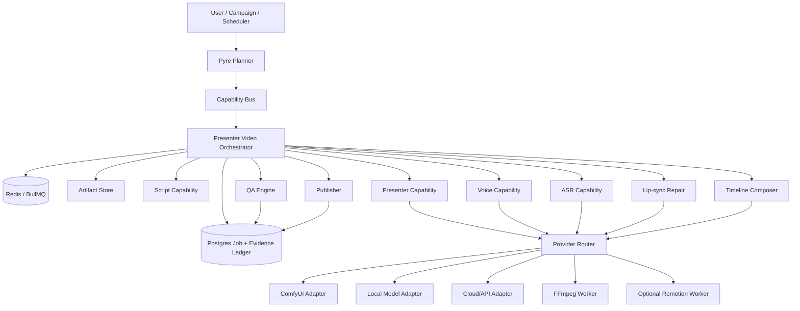
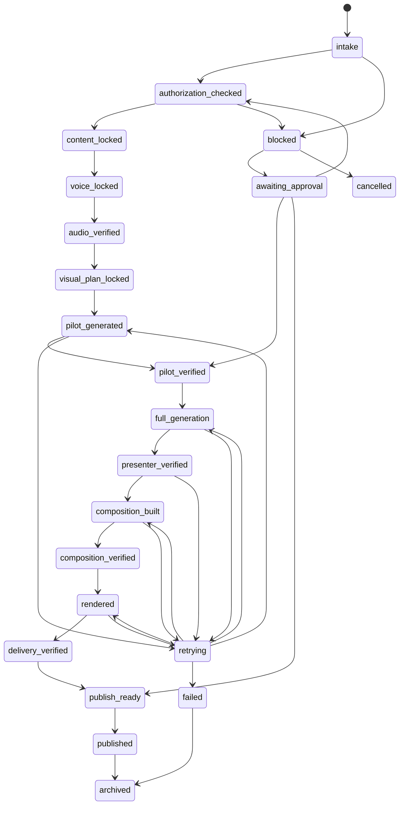

# Pyre Presenter Video Engine

## 1. Objetivo

Transformar um tema, roteiro, assets de marca e uma imagem autorizada de apresentador em vídeos publicados e auditáveis para Reels, TikTok, Shorts e outros destinos, mantendo o sistema **provider-neutral**, **idempotente**, **governado por custo** e **orientado a evidência**.

Capability principal:

```text
content.presenter-video.generate
```

Sub-capabilities:

```text
content.script.generate
content.script.polish
media.voice.synthesize
media.voice.clone
media.audio.normalize
media.asr.transcribe
media.asr.word_timestamps
media.presenter.generate
media.presenter.animate
media.lipsync.repair
media.video.broll.generate
media.timeline.compose
media.video.encode
media.video.qa
media.video.publish
```

---

## 2. Princípios

1. **Audio is master clock** — a narração final define o tempo do vídeo.
2. **Provider behind adapter** — nenhum agente conhece SDK de fornecedor.
3. **Capability before provider** — a solicitação pede semântica, não marca.
4. **Same-semantics fallback only** — fallback não pode alterar intenção da capability.
5. **Evidence before state transition** — estado muda somente quando existe evidência persistida.
6. **Pilot before expensive generation** — execução paga longa exige pilot aprovado.
7. **No blind retry** — cada falha é classificada antes de repetir.
8. **Immutable source assets** — originais não são alterados.
9. **No secrets in artifacts** — requests sanitizados; URLs temporárias nunca viram documentação.
10. **Publication is a side effect** — publicar exige capability separada e política explícita.

---

## 3. Macroarquitetura



---

## 4. Camadas

### 4.1 Control Plane

Responsável por intenção, política, estado e aprovação.

Componentes:

- Pyre Planner;
- Capability Bus;
- Job Orchestrator;
- Provider Router;
- Cost Governor;
- Approval Gate;
- Policy Engine;
- Job/Evidence Ledger.

Não renderiza vídeo diretamente.

### 4.2 Execution Plane

Executa trabalho pesado ou side effects:

- ComfyUI local/on-demand;
- workers GPU;
- FFmpeg workers;
- ASR local;
- APIs de voz;
- APIs de geração de vídeo;
- publicação em plataformas.

### 4.3 Knowledge Plane

- presets de marca;
- prompt packs;
- templates de roteiro;
- benchmark de providers;
- thresholds de QA;
- histórico de performance;
- custo observado;
- políticas de formato por plataforma.

### 4.4 Artifact Plane

Armazena:

- imagens originais;
- voice samples;
- raw narration;
- final narration;
- word timestamps;
- motion plates;
- candidatos;
- renders;
- captions;
- thumbnails;
- QA reports;
- delivery masters.

Git armazena apenas código, schemas, fixtures pequenas e documentação.

---

## 5. State machine



### Evidência mínima por estado

| Estado | Evidência obrigatória |
|---|---|
| `authorization_checked` | rights + adult + upload/voice policy |
| `content_locked` | script hash + version |
| `voice_locked` | voice strategy + provider config |
| `audio_verified` | final audio + ASR report + duration |
| `visual_plan_locked` | storyboard + timeline draft |
| `pilot_generated` | candidate asset + provider task |
| `pilot_verified` | technical + visual pilot QA |
| `full_generation` | generation records |
| `presenter_verified` | presenter QA report |
| `composition_built` | composition manifest |
| `composition_verified` | collision/safe-zone checks |
| `rendered` | render artifact |
| `delivery_verified` | decode/loudness/contact-sheet report |
| `publish_ready` | platform outputs + approval |
| `published` | destination post IDs/URLs |

---

## 6. Job model

O job é persistido em banco; `job.json` é apenas uma exportação/fixture.

Campos essenciais:

```text
job_id
workspace_id
campaign_id?
request_id
idempotency_key
capability
capability_version
state
state_version
created_at
updated_at
requested_by
language
audience
platform_targets
creative_spec
rights_policy
budget_policy
provider_policy
retry_policy
artifacts[]
evidence[]
provider_runs[]
approvals[]
qa_reports[]
publications[]
```

### Asset reference

```json
{
  "asset_id": "ast_01...",
  "kind": "audio.final",
  "uri": "artifact://jobs/job_01/audio/final.wav",
  "sha256": "...",
  "mime_type": "audio/wav",
  "duration_ms": 61234,
  "created_by_run_id": "run_01...",
  "provenance": {
    "source_asset_ids": ["ast_..."],
    "provider": "...",
    "model": "...",
    "version": "..."
  }
}
```

---

## 7. Audio lock

A narração final é produzida antes do presenter principal.

Fluxo:

```text
script
→ pronunciation map
→ voice selection
→ TTS/voice clone
→ concatenate sections
→ normalize section loudness
→ ASR
→ semantic diff
→ final audio lock
→ word timestamps
```

Após `audio_verified`, alterações de script ou voz criam uma **nova revision** e invalidam estados dependentes.

### Invalidation graph

```text
script changed
└─ invalidates voice_locked+

voice changed
└─ invalidates audio_verified+

audio duration changed
└─ invalidates visual_plan_locked+

presenter only changed
└─ preserves audio/word timestamps
```

---

## 8. Provider Router

### Entrada

- capability;
- job constraints;
- language;
- duration;
- dimensions;
- privacy policy;
- budget;
- latency target;
- local GPU availability;
- licensing policy;
- provider health.

### Candidate scoring

Configuração inicial, não hardcoded:

```text
quality_score        0.25
identity_score       0.20
lipsync_score        0.20
cost_score           0.15
latency_score        0.10
reliability_score    0.10
```

Para cada capability os pesos podem mudar.

Exemplo: presenter principal prioriza identidade/lip-sync; B-roll prioriza qualidade/custo.

### Hard gates antes do score

- provider habilitado;
- capability compatível;
- license policy compatível;
- região permitida;
- duração suportada;
- aspecto/resolução suportados;
- upload policy compatível;
- orçamento suficiente;
- health != degraded/disabled.

### Fallback

```text
primary provider fails
→ classify failure
→ poll existing job when remote
→ retry same provider if retryable
→ alternate provider only if same semantics
→ request approval if cost/privacy/appearance changes materially
```

---

## 9. Cost Governor

Cada provider run registra:

```text
estimated_cost
actual_cost
currency
pricing_basis
pricing_evidence_at
requested_units
billable_units
retry_number
```

Políticas:

- pilot budget separado do production budget;
- max retries por capability;
- max total job cost;
- stop após 3 candidatos pagos rejeitados por padrão;
- provider switch com aumento relevante de custo pode exigir approval;
- nunca submeter novo job remoto sem antes consultar task ID existente.

---

## 10. Approval model

Tipos:

```text
rights.presenter_image
rights.voice_clone
privacy.remote_upload
budget.paid_pilot
budget.full_generation
creative.pilot
creative.final_preview
publication.external_side_effect
```

Approval é ledger, não boolean perdido em JSON:

```json
{
  "approval_id": "apr_01...",
  "type": "budget.full_generation",
  "scope_hash": "sha256:...",
  "actor": "user:...",
  "approved_at": "...",
  "expires_at": null,
  "metadata": {
    "provider": "...",
    "estimated_cost": 1.42,
    "currency": "USD"
  }
}
```

Alterar o escopo invalida approval incompatível.

---

## 11. Failure taxonomy

```text
INPUT_INVALID
AUTHORIZATION_MISSING
REMOTE_UPLOAD_BLOCKED
VOICE_AUTH_MISSING
PROVIDER_UNAVAILABLE
PROVIDER_TIMEOUT
PROVIDER_RATE_LIMIT
PROVIDER_REJECTED_INPUT
PROVIDER_BILLING_ERROR
ARTIFACT_MISSING
ARTIFACT_CORRUPT
AUDIO_ASR_MISMATCH
AUDIO_CLIPPING
AUDIO_LOUDNESS_FAIL
IDENTITY_DRIFT
LIPSYNC_FAIL
HAND_ARTIFACT
EXPOSURE_DRIFT
FREEZE_DETECTED
BLACK_FRAME_DETECTED
CAPTION_COLLISION
SAFE_ZONE_COLLISION
TIMELINE_OFFSET_ERROR
ENCODE_FAIL
FULL_DECODE_FAIL
PUBLICATION_FAIL
POLICY_BLOCK
BUDGET_EXCEEDED
```

Cada classe aponta para:

- retryable?
- requires regeneration?
- requires repair?
- approval required?
- provider switch allowed?
- max attempts?

---

## 12. Timeline contract

```json
{
  "timeline_version": "1.0",
  "fps": 30,
  "width": 1080,
  "height": 1920,
  "duration_ms": 61234,
  "master_audio_asset_id": "ast_audio_final",
  "tracks": [
    {
      "id": "presenter",
      "muted": true,
      "clips": [
        {
          "asset_id": "ast_presenter_main",
          "start_ms": 0,
          "duration_ms": 61234,
          "source_offset_ms": 0
        }
      ]
    },
    {
      "id": "captions",
      "clips": []
    },
    {
      "id": "graphics",
      "clips": []
    }
  ]
}
```

Invariante:

```text
video sources muted
+ exactly one approved master narration path
```

---

## 13. Caption engine

Entrada:

- final audio;
- word timestamps;
- semantic segmentation;
- platform safe zones.

Saída:

- JSON interno;
- SRT;
- VTT;
- burned captions opcional.

Regras iniciais:

- frases curtas;
- 1 linha quando possível;
- destaque de no máximo um termo principal por frase;
- margin/safe-zone por destino;
- animação ligada ao timestamp real;
- nunca cobrir boca/olhos/UI principal.

---

## 14. QA Engine

### Machine QA

- ffprobe;
- dimensions;
- fps;
- streams;
- duration;
- loudness;
- clipping;
- full decode;
- black frames;
- exact-frame freezes;
- contact sheet;
- expected artifact hashes;
- caption bounds;
- timeline bounds.

### Visual/semantic QA

- identity consistency;
- lipsync;
- blinking;
- hands;
- gestures;
- exposure;
- background drift;
- subtitle readability;
- safe zones;
- message/script fidelity;
- end-tail behavior.

### Quality score

```text
technical_pass: bool
identity_score: 0..1
lipsync_score: 0..1
composition_score: 0..1
caption_score: 0..1
brand_score: 0..1
```

Thresholds devem ser configuráveis por workspace/template.

---

## 15. Composição

Backends possíveis:

1. **FFmpeg deterministic composer** — default mínimo, barato e reproduzível.
2. **Remotion adapter** — layouts complexos e motion design; sujeito à licença aplicável.
3. **ComfyUI** — geração/transformação visual, não deve ser o compositor final obrigatório.

Regra:

```text
composition contract != rendering backend
```

Isso permite trocar FFmpeg/Remotion sem mudar a semântica do job.

---

## 16. Publicação

`media.video.publish` é isolada da geração.

```text
generate → verified → publish_ready
                     ↓
              explicit policy
                     ↓
                  publish
```

Cada destino precisa adapter próprio:

- Instagram Reels;
- TikTok;
- YouTube Shorts;
- LinkedIn;
- X;
- storage/download only.

Registrar:

```text
platform
account_id
post_id
published_at
caption_version
asset_id
status
retry_count
```

---

## 17. n8n

n8n pode coordenar eventos, agendas e integrações, mas **não é o domínio do produto**.

Regra:

```text
Pyre/Capability API = contract boundary
n8n = orchestration client
```

Usuário final não recebe acesso à interface n8n. Isso também reduz acoplamento técnico e risco de licença quando Pyre evoluir para SaaS.

---

## 18. ComfyUI

ComfyUI deve funcionar como execution provider on-demand:

```text
Capability Bus
→ ComfyUI Adapter
→ workflow registry
→ submit prompt
→ poll history
→ collect artifacts
→ normalize result
```

Nunca:

```text
Pyre agent → hardcoded node IDs → ComfyUI workflow específico
```

O adapter resolve workflow por `workflow_key` e versão.

---

## 19. Observabilidade

Eventos mínimos:

```text
job.created
job.state.changed
approval.requested
approval.granted
provider.selected
provider.started
provider.polled
provider.completed
provider.failed
artifact.created
qa.completed
budget.updated
render.completed
publication.completed
```

Métricas:

```text
time_to_first_pilot
job_total_latency
provider_success_rate
cost_per_verified_video
cost_per_published_video
avg_retries
identity_fail_rate
lipsync_repair_rate
render_fail_rate
publication_fail_rate
```

---

## 20. Segurança e privacidade

- secrets apenas em secret manager/env governado;
- URLs assinadas/temporárias não persistem em logs compartilháveis;
- assets sensíveis com lifecycle/retention;
- audit log de uploads remotos;
- voice cloning exige autorização explícita;
- image rights e remote upload são gates separados;
- multi-tenant isolation por workspace;
- requests de provider sempre sanitizados antes de persistência.

---

## 21. Lifecycle da capability

```text
FEATURE
→ PROTOTYPE
→ VALIDATED
→ INTEGRATED
→ PRODUCTION
```

Critérios:

### FEATURE

- contratos documentados;
- architecture accepted;
- provider shortlist.

### PROTOTYPE

- job local;
- TTS;
- ASR;
- um presenter provider;
- FFmpeg finalizer;
- fixture end-to-end.

### VALIDATED

- pilot gate real;
- 10+ vídeos de benchmark;
- QA thresholds;
- custos registrados;
- recovery tests.

### INTEGRATED

- Capability Bus;
- Redis/BullMQ;
- Postgres ledger;
- n8n workflow;
- ComfyUI adapter;
- secrets/observability.

### PRODUCTION

- multi-tenant;
- quotas/budget;
- provider failover;
- platform publication;
- dashboards/SLOs;
- compliance/licensing review.
