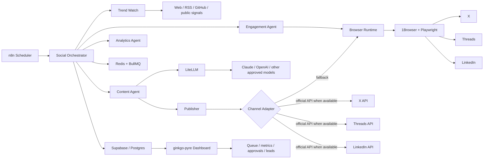

# Self-hosted Social Operations

Status: PROTOTYPE

## Objective

Replace Manus as the permanent social operator with Ginkgo-owned infrastructure while preserving the validated editorial loop: observe -> decide -> create -> publish -> engage -> measure -> learn.

Pyre becomes the control plane/cockpit. Execution is delegated through caller-agnostic capabilities.

## Target architecture



## Responsibilities

### n8n
- schedules cycles;
- triggers workflows;
- retry/backoff orchestration;
- low-code integrations;
- webhook intake.

### Social Orchestrator
- receives business intent;
- selects the next capability;
- applies channel policy;
- never embeds platform-specific browser logic.

### Trend Watch
- collects current AI, automation, GitHub and business-tech signals;
- ranks freshness, relevance and business applicability;
- persists source + timestamp + confidence.

### Content Agent
- generates platform-native drafts;
- X: realtime, short, high-frequency, technical/business hooks;
- Threads: conversational, opinionated, humanized;
- LinkedIn: projects, architecture, pains solved, new features, case-oriented authority.

### Publisher
- deduplicates;
- enforces per-channel pacing;
- schedules content;
- prefers official APIs;
- falls back to browser execution only when an API path is unavailable or intentionally disabled.

### Browser Runtime
Primary implementation: `1Browser + Playwright`.

Use a stable authenticated profile per legitimate Ginkgo identity. Do not rotate identity, fingerprint or IP merely to bypass platform enforcement. Browser automation exists for authorized account operation, QA, isolation and compatibility fallback.

### Redis + BullMQ
- queues;
- delayed jobs;
- concurrency limits;
- rate policies;
- transient state;
- retry counters.

### Supabase / Postgres
Persistent system of record for:
- posts;
- drafts;
- sources;
- metrics;
- leads;
- replies;
- executions;
- audit evidence;
- policy decisions.

## Capability model

Minimum capabilities:

- `social.signal.collect`
- `social.signal.rank`
- `social.content.draft`
- `social.content.review`
- `social.publish`
- `social.engage.prepare`
- `social.engage.execute`
- `social.metrics.collect`
- `social.lead.detect`

Execution routing:

```text
API available and authorized?
  yes -> official channel adapter
  no  -> browser.runtime
```

The caller must not care which executor fulfills the capability.

## Lifecycle

```text
DRAFT -> REVIEW -> SCHEDULED -> RUNNING -> PUBLISHED -> MEASURED
```

Additional terminal states:

```text
BLOCKED | FAILED | CANCELLED
```

## Approval policy

Low-risk content publication can become autonomous after validation.

Keep approval gates for higher-risk actions such as:
- direct-message outreach;
- changing profile/account settings;
- deleting content;
- changing authentication/security;
- purchases or paid media;
- high-volume relationship actions.

## Initial channel policy

### X
Goal: fast discovery and high experimentation velocity.

Content:
- AI launches;
- agent systems;
- automation for businesses;
- open-source discoveries;
- sharp technical/business observations;
- concise threads when useful.

### Threads
Goal: conversation and distribution through approachable commentary.

Content:
- provocative questions;
- practical AI-business observations;
- behind-the-scenes building notes;
- reactions to current tools and launches.

### LinkedIn
Goal: institutional authority and commercial proof.

Source material should preferentially come from Ginkgo GitHub projects and validated work.

Each post should answer at least three of:
- what pain exists;
- what was built;
- how it works;
- which feature is new;
- what operational result it targets;
- what architecture/technical choice matters;
- who benefits.

## Metrics loop

Per publication persist:
- platform;
- source signal;
- content family;
- published_at;
- impressions/views;
- likes;
- replies/comments;
- reposts/shares;
- clicks;
- follower delta where available;
- qualified lead signals.

Classify outcomes as `WINNER`, `NORMAL` or `WEAK` using configurable thresholds. Feed winning patterns back into `social.content.draft`, but do not blindly repeat text or engagement patterns.

## Non-goals

This architecture is not intended to:
- bypass suspensions or platform controls;
- perform fake engagement;
- mass-DM unsolicited users;
- mass-follow/unfollow;
- rotate identities to evade detection.

## Production direction

Manus becomes optional tooling, not a runtime dependency. The permanent operator becomes:

```text
Hostinger VPS
  -> n8n
  -> Social Orchestrator
  -> Redis/BullMQ
  -> LiteLLM
  -> Supabase/Postgres
  -> official APIs or 1Browser/Playwright
  -> ginkgo-pyre control plane
```
