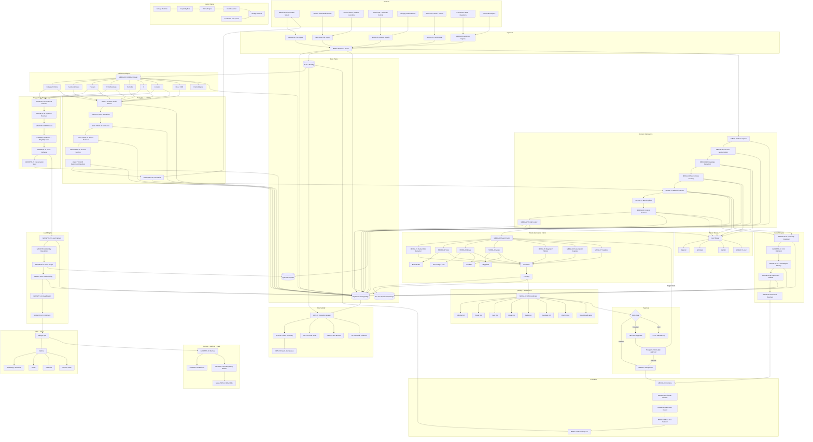
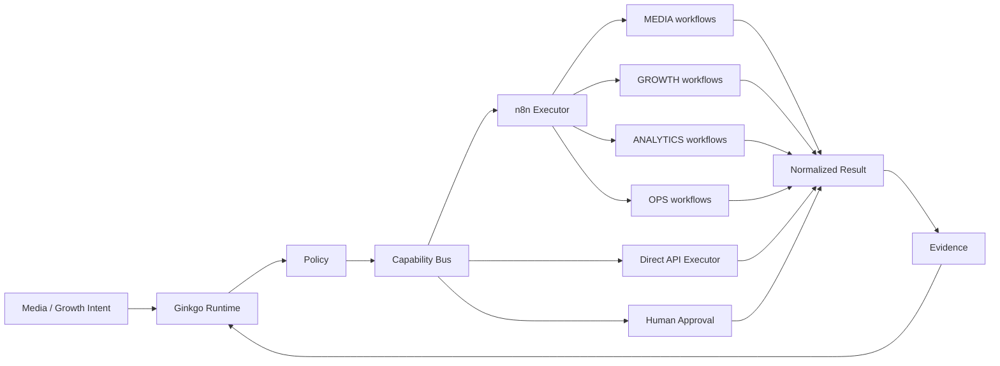
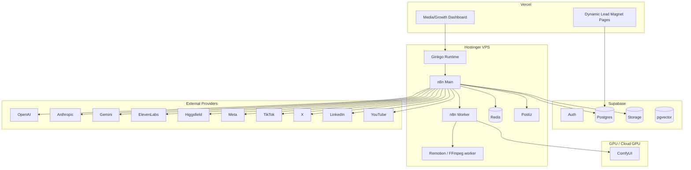

# Ginkgo Growth — Technical Architecture

## End-to-end topology

## Runtime boundary

## Physical deployment target

## Design rule

No provider, social network, or model is allowed to become the architecture. All integrations must be replaceable behind contracts and adapters.