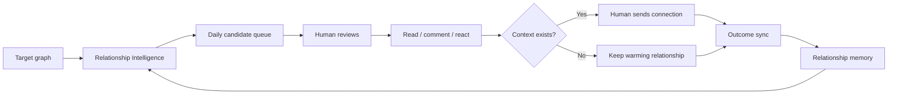
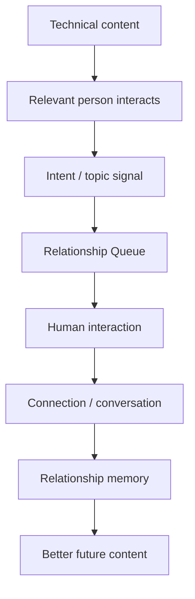

# Global Positioning and Network Presence

Ginkgo Growth must operate as a global distribution system, not as a set of isolated social accounts.

The canonical model is:

`ONE IDEA -> BRAND INTERPRETATION -> MARKET/LOCALE ADAPTATION -> PLATFORM-NATIVE DISTRIBUTION -> RELATIONSHIP -> INTENT -> CRM`

## Positioning

### Ginkgo

Global technology company positioning.

Primary themes:

- AI infrastructure and AI Employees;
- agent/runtime architecture;
- applied research and benchmarks;
- automation systems;
- product engineering;
- governed capabilities and execution;
- real customer outcomes;
- technical releases and experiments.

Reference class: research/product companies such as OpenAI, Anthropic, xAI and Meta AI. The objective is not to imitate their visual identity or wording; it is to adopt the same category discipline: product, engineering, research, releases, evidence and long-term technical narrative.

### Gabriel

Founder-builder / engineer positioning.

Primary themes:

- building real systems;
- technical deep dives;
- architecture decisions;
- experiments and benchmarks;
- engineering opinions with evidence;
- tools actually used;
- lessons from failures and trade-offs;
- founder/operator perspective.

The content should preserve a personal technical voice instead of becoming a corporate mirror of Ginkgo.

## Language strategy

Every important technical idea is created as a language-neutral canonical content object first.

Required fields:

```text
canonical_idea_id
brand_id
source_language
market
locale
translation_mode
technical_terms_locked
canonical_claims
canonical_links
```

Recommended rollout:

1. **English** — canonical global version for Ginkgo, LinkedIn, X, YouTube, blog and technical artifacts.
2. **PT-BR** — localized version for Brazilian audience and Gabriel's native authority.
3. **Spanish** — optional next market only after English/PT-BR operating data is stable.

Do not machine-translate and publish blindly. Technical names, claims, code and product terminology must be locked before localization.

## Platform roles

| Platform | Gabriel | Ginkgo | Primary objective |
|---|---|---|---|
| LinkedIn | founder + engineering authority | institutional/product/research | relationships, B2B trust, opportunities |
| X | technical opinions, build-in-public, threads | releases, engineering notes, research | global technical graph |
| Threads | lightweight theses and conversation | secondary reach | conversation/discovery |
| Instagram | face, clips, carousels, demos | visual product/engineering | reach + follow + DM funnels |
| TikTok | high-retention explanations/demos | short-form experiments | discovery |
| YouTube | long technical sessions/deep dives | demos/research/product | durable authority |
| Blog | canonical technical writing | engineering/research archive | search + durable knowledge |
| Newsletter | weekly synthesis | releases/research digest | owned audience |
| GitHub | proof and technical source material | source artifacts | credibility/reproducibility |

## LinkedIn: relationship engine

LinkedIn must not be treated only as a publishing channel. It is a relationship graph.

The automation should create a **Relationship Queue**, but connection requests, sensitive outreach and substantive relationship interactions remain human-controlled.

### Why human-in-the-loop

LinkedIn explicitly limits invitations and may restrict accounts that send too many invitations, receive low acceptance, or use prohibited automation. Therefore Ginkgo Growth must never implement browser bots, scraping extensions or autonomous connection requests.

### Daily LinkedIn loop

Target operator time: 20–30 minutes/day.



### Relationship Intelligence may automate

- discover public companies/roles through permitted sources;
- prioritize people by relevance;
- detect overlap with Ginkgo topics;
- summarize a person's recent public work when available;
- suggest a useful comment;
- suggest a concise connection reason;
- create a daily queue;
- record manual outcome;
- remind Gabriel about important relationships;
- surface inbound interactions that deserve a response.

### Relationship Intelligence must not automate

- sending LinkedIn invitations;
- mass DMs;
- fake reactions/comments;
- browser scraping prohibited by LinkedIn;
- automatic interaction intended to simulate a human;
- connection farming without context.

## Target relationship graph

Prioritize:

1. AI/ML engineers and researchers.
2. Founders of AI, SaaS and automation companies.
3. n8n / agent / infrastructure builders.
4. CTOs, CIOs and technical operators.
5. B2B founders with operational pain Ginkgo can solve.
6. Technical creators and educators.
7. Open-source maintainers.
8. Investors/operators in AI infrastructure and SaaS.
9. Potential partners and integration providers.
10. High-signal customers and community members.

Every relationship should have a reason. The objective is a useful graph, not a vanity connection count.

## Daily presence score

The system can calculate a non-gamified presence score to ensure consistency:

```text
presence_score =
  relevant_replies
+ substantive_comments
+ inbound_responses
+ profile_visits_from_target_graph
+ accepted_contextual_connections
+ post_quality_signals
+ newsletter/blog engagement
```

Follower count alone is not a success metric.

## Content-to-relationship loop



## Global account discipline

- Keep one canonical Ginkgo identity unless a market has enough volume to justify a separate regional account.
- Avoid identical cross-post copy; adapt to platform context.
- Use English as the default global technical artifact.
- Localize high-performing assets rather than translating every post.
- Preserve canonical URLs and source references.
- Use UTC internally; render posting schedules in target-market local time.
- Store `market`, `locale`, `timezone`, `platform` and `audience_segment` on every publish job.

## Network workflow IDs

Recommended n8n/control-plane workflow family:

```text
NETWORK-01 Target Graph Import
NETWORK-02 Relationship Scoring
NETWORK-03 Daily Relationship Queue
NETWORK-04 Comment/Reply Opportunity Brief
NETWORK-05 Human Connection Brief
NETWORK-06 Outcome Sync
NETWORK-07 Relationship Memory Update
NETWORK-08 Inbound Priority Router
```

These workflows generate intelligence and queues. They do not autonomously operate the LinkedIn UI.
