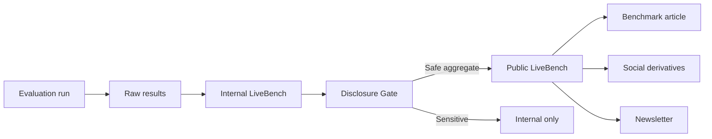
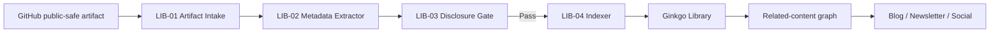
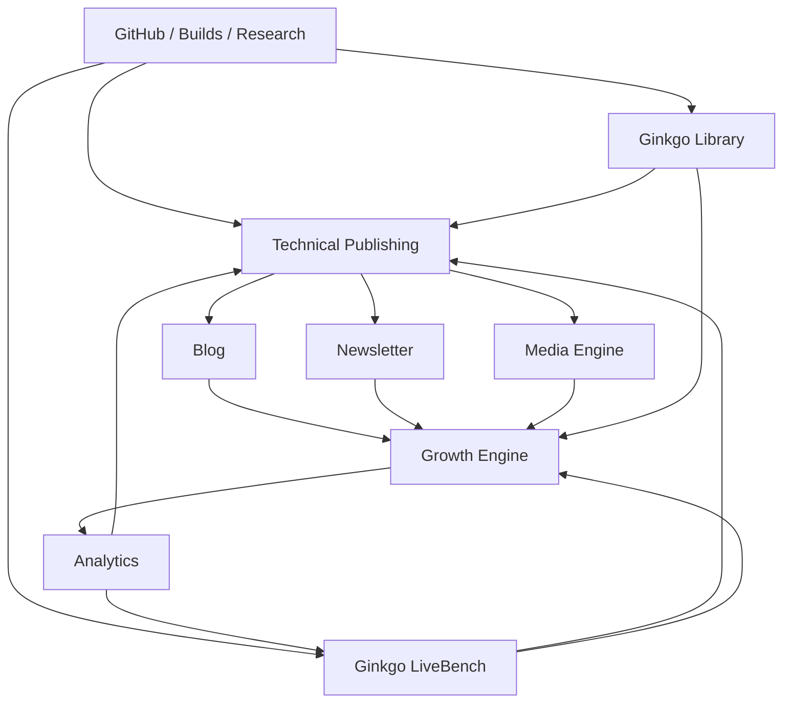

# Ginkgo LiveBench + Library

LiveBench and Library are two permanent authority surfaces for Ginkgo Growth.

- **Ginkgo LiveBench** turns real system measurements into continuously updated, reproducible public evidence.
- **Ginkgo Library** turns useful technical artifacts into a searchable, durable knowledge/resource layer.

They should be first-class navigation items on the technical site.

## Ginkgo LiveBench

LiveBench is not a marketing leaderboard. It is a benchmark publication surface backed by versioned evaluation runs.

### Public categories

```text
/livebench/models
/livebench/agents
/livebench/media
/livebench/workflows
/livebench/content
```

### Models

Possible metrics:

- task success rate;
- structured-output validity;
- tool/capability selection accuracy;
- latency p50/p95;
- cost per successful task;
- retry rate;
- hallucination/invalid-call rate;
- coding/eval score where a reproducible suite exists.

### Agents / Capabilities

Measure complete capability execution instead of model vibes.

Examples:

- `content.extract`;
- `content.write`;
- `media.transcribe`;
- `image.generate`;
- `video.generate`;
- `social.publish`;
- `analytics.collect`.

Metrics:

```text
success_rate
policy_pass_rate
provider_fallback_rate
p50_latency
p95_latency
cost_per_success
human_intervention_rate
replay_success_rate
```

### Media providers

Compare providers/workflows for real production tasks:

- TTS;
- transcription;
- image generation;
- video generation;
- lip sync;
- character consistency;
- render pipelines.

Possible dimensions:

```text
quality_score
brand_fit
latency
cost
failure_rate
consistency
revision_count
```

### n8n / workflows

Operational benchmark for critical chains:

```text
throughput
success_rate
p95_execution_time
retry_rate
DLQ_rate
cost_per_execution
provider_dependency
```

### Content / Growth experiments

Public only when aggregate data is safe to disclose.

Examples:

- hook families;
- short-form duration;
- CTA type;
- retention curves;
- save/share/comment conversion;
- lead-magnet conversion.

Never expose customer-level or commercially sensitive performance data.

## Internal vs public LiveBench



Internal LiveBench can contain full operational metrics.

Public LiveBench contains only sanitized, reproducible and disclosure-approved results.

## Reproducibility contract

Every public benchmark snapshot must carry:

```json
{
  "benchmark_id": "model-routing-v2",
  "run_id": "uuid",
  "benchmark_version": "2.1.0",
  "executed_at": "ISO-8601",
  "subject": "provider/model/workflow version",
  "dataset_version": "sha/version",
  "environment": "public-safe runtime summary",
  "sample_count": 100,
  "scoring_method": "versioned evaluator",
  "result_ref": "benchmark_result:id",
  "methodology_ref": "library:methodology-id"
}
```

No public score without methodology.

## LiveBench update modes

### Scheduled

Daily/weekly benchmark runs.

### Release-triggered

A model/provider/runtime release creates a candidate rerun.

### Drift-triggered

Operational telemetry detects a material performance change and requests a benchmark rerun.

### Manual challenge

Gabriel/Ginkgo can create a controlled benchmark around a technical question.

## LiveBench workflow family

```text
BENCH-01 Eval Plan Builder
BENCH-02 Eval Runner
BENCH-03 Result Normalizer
BENCH-04 Statistical/Quality Validator
BENCH-05 Cost + Latency Join
BENCH-06 Disclosure Gate
BENCH-07 Public Snapshot Publisher
BENCH-08 Benchmark Article Trigger
BENCH-09 Regression/Drift Monitor
BENCH-10 Historical Ranking Refresh
```

---

# Ginkgo Library

The Library is the public resource index behind the content ecosystem.

Recommended route:

`/library`

## Library collections

```text
Articles
Engineering Notes
Research Notes
Benchmark Methodologies
LiveBench Snapshots
Architecture Diagrams
Public Workflows / Blueprints
Prompts
Templates
Checklists
Code / GitHub Repositories
Talks / Live Transcripts
Demos
Release Notes
Tools
Datasets / Eval Definitions when publishable
```

## Library item contract

```json
{
  "library_item_id": "uuid",
  "type": "article|benchmark|workflow|prompt|diagram|repo|talk|tool|dataset",
  "title": "string",
  "summary": "string",
  "tags": ["agents", "n8n", "runtime"],
  "locale": "en",
  "canonical_url": "string",
  "source_refs": ["github:..."],
  "artifact_refs": ["storage:..."],
  "license": "string|null",
  "public_safe": true,
  "published_at": "ISO-8601",
  "updated_at": "ISO-8601"
}
```

## Library UX

Minimum capabilities:

- full-text search;
- tags;
- type filters;
- language filter;
- newest / updated / popular sorting;
- related resources;
- canonical source link;
- download/action CTA where appropriate;
- RSS/feed surfaces;
- machine-readable metadata;
- stable URLs.

## Library as a growth surface

Some items are fully open. Others can be used as lead magnets.

Examples:

```text
Public article -> open
Architecture diagram -> open
Benchmark methodology -> open
Basic workflow blueprint -> open
Importable workflow pack -> optional email/DM capture
Advanced audit template -> campaign asset
```

The library must not become a wall of gated PDFs. Open technical value builds authority and backlinks; selective high-intent assets power acquisition.

## GitHub -> Library



## Library workflow family

```text
LIB-01 Artifact Intake
LIB-02 Metadata + Tag Extractor
LIB-03 Disclosure / License Gate
LIB-04 Search Indexer
LIB-05 Related Resource Graph
LIB-06 Localization
LIB-07 Popularity/Utility Scoring
LIB-08 Revision Sync
LIB-09 Feed/RSS Refresh
LIB-10 Lead-Magnet Binding
```

## Architecture relationship



## Strategic invariant

LiveBench creates **evidence**.

Library creates **memory and discoverability**.

Blog/Newsletter create **narrative**.

Social creates **distribution**.

Growth converts the resulting attention into **relationships, intent and revenue**.
