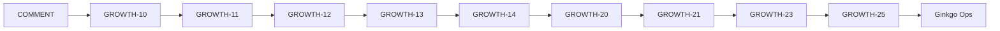
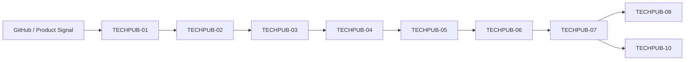
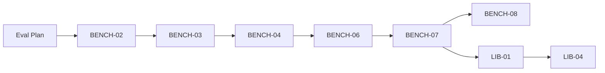

# n8n Workflow Catalog

n8n is the execution fabric for Ginkgo Growth. Workflows must be small, replayable, observable and contract-driven.

## MEDIA

| ID | Workflow | Trigger | Output |
|---|---|---|---|
| MEDIA-00 | Intake Router | webhook/event | normalized source |
| MEDIA-01 | Live Ingest | stream end / webhook | source asset |
| MEDIA-02 | File Ingest | upload | source asset |
| MEDIA-03 | Product Signals | GitHub/product event | public-content candidate |
| MEDIA-04 | Trend Radar | schedule/search signal | trend candidate |
| MEDIA-05 | Audience Signals | comment/DM/analytics | audience signal |
| MEDIA-10 | Transcription | source.ready | transcript |
| MEDIA-11 | Semantic Segmentation | transcript.ready | segments |
| MEDIA-12 | Knowledge Extraction | segments.ready | claims/topics/stories |
| MEDIA-13 | Topic + Hook Scoring | knowledge.ready | ranked ideas |
| MEDIA-14 | Editorial Planner | ranked ideas + analytics | editorial plan |
| MEDIA-15 | Brand Splitter | editorial plan | Gabriel/Ginkgo variants |
| MEDIA-16 | Content Atomizer | approved idea | asset candidates |
| MEDIA-17 | Script Factory | asset candidate | platform scripts |
| MEDIA-20 | Asset Router | media request | provider plan |
| MEDIA-21 | Human Clip Extractor | source segment | clip |
| MEDIA-22 | Voice Generation | voice request | audio asset |
| MEDIA-23 | Image Generation | image request | image asset |
| MEDIA-24 | Video Generation | video request | video asset |
| MEDIA-25 | Diagram/Motion | visual request | SVG/video component |
| MEDIA-26 | Screenshot/Capture | URL/demo instruction | capture asset |
| MEDIA-27 | Caption Engine | transcript + video | timed captions |
| MEDIA-28 | Remotion Render | composition request | rendered video |
| MEDIA-29 | FFmpeg Process | render output | platform variants |
| MEDIA-30 | QA Coordinator | asset.ready | QA aggregate |
| MEDIA-31 | Fact QA | claims | evidence/flags |
| MEDIA-32 | Visual QA | visual asset | quality score |
| MEDIA-33 | Brand QA | content asset | brand score |
| MEDIA-34 | Duplicate QA | content asset | duplication score |
| MEDIA-35 | Risk Classifier | content asset | GREEN/YELLOW/RED |
| MEDIA-36 | Approval Gateway | YELLOW/RED | approval event |
| MEDIA-40 | Content Inventory | approved asset | schedulable inventory |
| MEDIA-41 | Calendar Planner | inventory + campaigns | posting plan |
| MEDIA-42 | Saturation Guard | posting plan | de-duplicated plan |
| MEDIA-43 | Best-time Selector | plan + analytics | scheduled slots |
| MEDIA-44 | Publish Queue | scheduled slot | queued publish job |
| MEDIA-50 | Publisher Router | publish job | adapter selection |
| MEDIA-51..58 | Platform Adapters | normalized publish request | normalized publish result |

## GROWTH

| ID | Workflow | Trigger | Output |
|---|---|---|---|
| GROWTH-01 | Campaign Designer | idea/campaign request | campaign |
| GROWTH-02 | CTA Optimizer | campaign + platform | CTA variants |
| GROWTH-03 | Lead Magnet Factory | campaign | deliverable asset |
| GROWTH-04 | Experiment Builder | campaign/asset | variants + hypothesis |
| GROWTH-05 | Funnel Resolver | campaign | funnel state machine |
| GROWTH-10 | Comment Listener | platform webhook | normalized interaction |
| GROWTH-11 | Keyword Resolver | interaction | campaign match |
| GROWTH-12 | DM Router | campaign match | DM request |
| GROWTH-13 | Follow/Eligibility Gate | DM state | eligibility decision |
| GROWTH-14 | Asset Delivery | eligible contact | delivery result |
| GROWTH-15 | Conversation State | DM/reply | state transition |
| GROWTH-20 | Lead Capture | asset request / form | contact candidate |
| GROWTH-21 | Identity Resolution | contact candidate | unified identity |
| GROWTH-22 | Intent Graph | interaction stream | intent signals |
| GROWTH-23 | Lead Scoring | intent signals | score/tier |
| GROWTH-24 | Qualification | score + answers | MQL/SQL decision |
| GROWTH-25 | CRM Sync | qualified contact | Ginkgo Ops record |
| GROWTH-30 | Nurture Engine | CRM/contact event | nurture action |
| GROWTH-31 | Referral Engine | campaign/contact event | referral state |
| GROWTH-32 | Retargeting Builder | consented audience event | ad audience signal |

## NETWORK / RELATIONSHIP INTELLIGENCE

These workflows create intelligence and queues. They must not autonomously operate LinkedIn invitations, scrape prohibited UI surfaces or fake human engagement.

| ID | Workflow | Trigger | Output |
|---|---|---|---|
| NETWORK-01 | Target Graph Import | schedule/manual/source update | candidate identities |
| NETWORK-02 | Relationship Scoring | candidate update | relevance score |
| NETWORK-03 | Daily Relationship Queue | daily schedule | human action queue |
| NETWORK-04 | Comment/Reply Opportunity Brief | public interaction/content signal | suggested context/action |
| NETWORK-05 | Human Connection Brief | relationship threshold | connection reason/note suggestion |
| NETWORK-06 | Outcome Sync | manual action result | relationship event |
| NETWORK-07 | Relationship Memory Update | relationship event | updated graph/memory |
| NETWORK-08 | Inbound Priority Router | mention/comment/DM/invite | prioritized response queue |

## TECHNICAL PUBLISHING

| ID | Workflow | Trigger | Output |
|---|---|---|---|
| TECHPUB-01 | GitHub/Product Signal Intake | PR/release/milestone/product event | technical signal |
| TECHPUB-02 | Public Relevance Classifier | technical signal | publishability candidate |
| TECHPUB-03 | Redaction + Disclosure Gate | candidate | pass/block/review |
| TECHPUB-04 | Technical Draft Builder | approved source/evidence | article draft |
| TECHPUB-05 | Evidence Linker | draft + source refs | claim/evidence graph |
| TECHPUB-06 | Article QA | draft | QA/risk result |
| TECHPUB-07 | Blog Publisher | approved article | canonical article URL |
| TECHPUB-08 | Newsletter Composer | weekly graph/article event | newsletter draft |
| TECHPUB-09 | Newsletter Publisher | approved newsletter | delivery result |
| TECHPUB-10 | Social Derivative Trigger | article published | Media Engine requests |
| TECHPUB-11 | Article Revision Monitor | source/benchmark changed | revision candidate |
| TECHPUB-12 | RSS/Search Index Refresh | publish/update | feed/index refresh |

## LIVEBENCH

| ID | Workflow | Trigger | Output |
|---|---|---|---|
| BENCH-01 | Eval Plan Builder | schedule/release/manual challenge | versioned eval plan |
| BENCH-02 | Eval Runner | eval plan | raw evaluation results |
| BENCH-03 | Result Normalizer | raw result | normalized benchmark rows |
| BENCH-04 | Statistical/Quality Validator | normalized results | valid/invalid run |
| BENCH-05 | Cost + Latency Join | validated results + usage telemetry | benchmark economics |
| BENCH-06 | Disclosure Gate | benchmark snapshot | public/internal decision |
| BENCH-07 | Public Snapshot Publisher | approved snapshot | LiveBench page/data |
| BENCH-08 | Benchmark Article Trigger | public snapshot | TECHPUB signal |
| BENCH-09 | Regression/Drift Monitor | telemetry/new snapshots | rerun/regression event |
| BENCH-10 | Historical Ranking Refresh | public snapshot | ranking/history update |

## LIBRARY

| ID | Workflow | Trigger | Output |
|---|---|---|---|
| LIB-01 | Artifact Intake | public-safe article/repo/workflow/benchmark asset | library candidate |
| LIB-02 | Metadata + Tag Extractor | candidate | normalized metadata |
| LIB-03 | Disclosure / License Gate | metadata + source | pass/block/review |
| LIB-04 | Search Indexer | approved item | indexed library item |
| LIB-05 | Related Resource Graph | indexed item | related-item edges |
| LIB-06 | Localization | approved item | localized variant |
| LIB-07 | Popularity/Utility Scoring | usage analytics | item score |
| LIB-08 | Revision Sync | source changed | item update |
| LIB-09 | Feed/RSS Refresh | item publish/update | feed/index refresh |
| LIB-10 | Lead-Magnet Binding | campaign request | campaign-library binding |

## ANALYTICS

| ID | Workflow | Trigger | Output |
|---|---|---|---|
| ANALYTICS-01 | Metrics Collector | 1h/6h/24h/72h/7d | raw snapshots |
| ANALYTICS-02 | Normalizer | raw snapshot | normalized metrics |
| ANALYTICS-03 | Attribution | normalized metrics | campaign/source attribution |
| ANALYTICS-04 | Winner Detector | attributed performance | winner/loser status |
| ANALYTICS-05 | Growth Scoring | post + funnel metrics | growth score |
| ANALYTICS-06 | Experiment Resolver | variant metrics | winning variant |
| ANALYTICS-07 | Next Brief Generator | winners + audience signals | next live/editorial brief |

## OPS

| ID | Workflow | Purpose |
|---|---|
| OPS-01 | execution logger |
| OPS-02 | failure recovery |
| OPS-03 | dead-letter handler |
| OPS-04 | cost meter |
| OPS-05 | SLA monitor |
| OPS-06 | audit evidence |

## Queue topics

```text
source.ingested
transcript.requested
transcript.ready
segments.ready
knowledge.ready
content.plan.ready
asset.requested
asset.ready
render.requested
render.ready
qa.requested
qa.passed
approval.requested
publish.requested
publish.completed
engagement.received
lead.updated
relationship.candidate
relationship.action_requested
relationship.updated
technical_signal.received
disclosure.review_requested
article.draft_ready
article.published
newsletter.ready
benchmark.requested
benchmark.completed
benchmark.public_snapshot
library.item_ready
library.item_published
analytics.snapshot
experiment.resolved
```

## Workflow contract

Every workflow MUST expose equivalent metadata:

```json
{
  "workflow_id": "MEDIA-24",
  "contract_version": "1.0",
  "execution_id": "uuid",
  "correlation_id": "uuid",
  "input_ref": "asset_request:123",
  "status": "success|failed|blocked",
  "provider": "higgsfield",
  "latency_ms": 1200,
  "cost_usd": 0.42,
  "output_refs": ["media_asset:456"],
  "evidence_refs": ["execution_evidence:789"]
}
```

## Retry policy

- 429 / provider capacity: exponential retry with jitter.
- 5xx transient: bounded retry.
- 4xx validation/auth: no blind retry; classify and escalate.
- duplicate webhook: idempotent no-op.
- exhausted retries: Dead Letter Queue + alert + recovery workflow.

## Kill switches

Minimum kill switches:

```text
PUBLISHING_GLOBAL_ENABLED
PUBLISHING_<PLATFORM>_ENABLED
SYNTHETIC_VOICE_ENABLED
SYNTHETIC_VIDEO_ENABLED
DM_AUTOMATION_ENABLED
FOLLOW_GATE_ENABLED
PAID_AMPLIFICATION_ENABLED
TECHPUB_AUTOPUBLISH_ENABLED
LIVEBENCH_PUBLIC_PUBLISH_ENABLED
LIBRARY_PUBLIC_PUBLISH_ENABLED
NETWORK_RELATIONSHIP_QUEUE_ENABLED
```

There is deliberately no `LINKEDIN_AUTO_CONNECT_ENABLED` kill switch because autonomous connection sending is outside the design boundary.

## P0 workflow chain

```mermaid
flowchart LR
  A[LIVE] --> B[MEDIA-01]
  B --> C[MEDIA-10]
  C --> D[MEDIA-11]
  D --> E[MEDIA-14]
  E --> F[MEDIA-16]
  F --> G[MEDIA-17]
  G --> H[MEDIA-21]
  H --> I[MEDIA-27]
  I --> J[MEDIA-28]
  J --> K[MEDIA-30]
  K --> L[MEDIA-44]
  L --> M[MEDIA-50]
  M --> N[ANALYTICS-01]
```



P0 Growth:



Technical authority chain:



LiveBench/Library chain:


