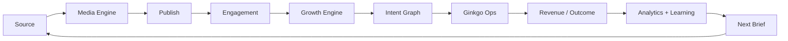

# Ginkgo Growth

Ginkgo Growth is the growth operating layer for Pyre/Ginkgo Media Engine.

Its job is not merely to publish content. It converts source material, product signals and audience interactions into a closed growth loop:

`SOURCE -> CONTENT -> DISTRIBUTION -> ENGAGEMENT -> INTENT -> LEAD -> CRM -> REVENUE -> LEARNING -> NEXT CONTENT`

## Operating boundary

- **Pyre / Media Engine**: content intelligence, repurposing, generation, rendering, QA and publishing.
- **Ginkgo Growth**: campaigns, CTAs, comment-to-DM, lead magnets, qualification, nurture, referral, retargeting, experiments and attribution.
- **Ginkgo Runtime**: policy and capability routing.
- **Ginkgo Arsenal**: provider/capability registry, credential refs, cost/fallback policies.
- **n8n**: execution fabric. It must not become the editorial brain.
- **Ginkgo Ops**: CRM system of record for qualified contacts and commercial context.
- **Callima**: conversational qualification, nurture, handoff and booking.

## Primary sources

1. Gabriel live/video/audio sessions.
2. Manual uploads and demos.
3. GitHub PRs, releases and product events.
4. Ginkgo product telemetry and public milestones.
5. Research/news/trend signals.
6. Comments, DMs, questions and audience requests.
7. Historical analytics.

## Core loop



## Extended authority surfaces

Ginkgo Growth also includes durable technical-distribution surfaces:

- **Global Positioning** — global-first content graph, locale/market adaptation and network presence.
- **LinkedIn Relationship Engine** — relationship intelligence and human-operated connection queue; no autonomous connection farming.
- **Technical Blog** — canonical long-form source of truth with search, tags, archive, RSS, GitHub evidence and technical revisions.
- **Newsletter** — weekly synthesis generated from the canonical technical graph, not a separate content silo.
- **Ginkgo LiveBench** — public-safe, reproducible benchmark snapshots from real model/provider/workflow evaluations.
- **Ginkgo Library** — searchable public index of articles, benchmark methodologies, workflows, prompts, diagrams, repositories, talks and technical resources.

## Canonical growth patterns

- Comment keyword -> DM -> follow/eligibility gate -> asset delivery.
- DM keyword -> lead magnet -> identity resolution -> intent score.
- Quiz / calculator / audit -> qualification -> CRM.
- Template/workflow/prompt drop -> email capture -> nurture.
- Part 1/2/3 content series -> profile discovery -> follow.
- Save/share CTAs for utility content.
- Reply mining -> new content generation.
- Winner detection -> variants -> cross-platform amplification -> paid candidate.
- Referral unlocks.
- Retargeting audiences from high-intent interactions.
- GitHub/release -> public-safety gate -> technical article -> newsletter -> social derivatives.
- LiveBench update -> benchmark article -> Library snapshot -> social/newsletter distribution.
- Target relationship graph -> daily human relationship queue -> relationship memory -> better future content.

## Risk classes

- **GREEN**: evergreen education, derived clips, approved templates, routine posts; can autopublish.
- **YELLOW**: strong opinions, competitor comparisons, synthetic speech attributed to Gabriel, numbers, unreleased features; requires approval.
- **RED**: legal, crisis, confidential client data, politics, sensitive claims, destructive account changes; manual only.

## Repository map

```text
docs/ginkgo-growth/
├── README.md
├── ARCHITECTURE.md
├── N8N-WORKFLOWS.md
├── DATA-CONTRACTS.md
├── PROVIDERS.md
├── GLOBAL-POSITIONING.md
├── TECH-PUBLISHING.md
├── LIVEBENCH-LIBRARY.md
├── ROADMAP.md
└── IMPORT-RUNBOOK.md
```

## Non-negotiable invariants

1. n8n orchestrates execution; policy remains outside individual workflows.
2. Every workflow has owner, input contract, output contract, retry policy, logs, evidence and kill switch.
3. Provider-specific payloads stay behind adapters.
4. Every social interaction is normalized before business logic.
5. Every content asset carries brand, objective, campaign, CTA, platform and risk metadata.
6. All automated external publishing must pass platform policy and internal QA.
7. No secrets, cookies, session exports or raw credentials are committed to Git.
8. All synthetic media must preserve provenance internally.
9. Analytics must attribute performance to source, topic, hook, template, CTA, campaign and cost.
10. Growth automation must respect platform permissions and user intent; no unsolicited DM spam or fake engagement.
11. Private GitHub artifacts are not publishable by default; technical publishing requires an explicit disclosure/public-safety gate.
12. LinkedIn relationship automation may prioritize and brief humans but must not autonomously send invitations, scrape the UI or simulate human engagement.
13. Public LiveBench scores require versioned methodology, evidence and disclosure approval.
14. Blog is the canonical long-form source; newsletter and social are derivatives/syndication surfaces.

## P0 target

P0 is complete only when one real source can run end-to-end:

`LIVE -> TRANSCRIPT -> SEGMENTS -> CONTENT -> RENDER -> QA -> PUBLISH -> COMMENT KEYWORD -> DM -> ASSET -> CONTACT -> GINKGO OPS -> ANALYTICS`

The next authority milestones are:

`GITHUB SIGNAL -> DISCLOSURE GATE -> BLOG -> NEWSLETTER -> SOCIAL`

and:

`EVAL RUN -> LIVEBENCH -> LIBRARY -> TECHNICAL CONTENT -> GROWTH`

See the remaining documents for the implementation contracts.
