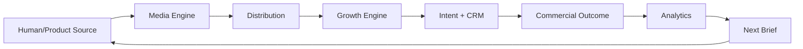

# Ginkgo Growth — Implementation Roadmap

Build in slices. Do not attempt the full autonomous system in one n8n canvas.

## P0 — Human-source media pipeline

Goal: turn one real long-form source into published content with evidence.

Required path:

`LIVE -> INGEST -> TRANSCRIPT -> SEGMENTS -> PLAN -> SCRIPT -> HUMAN CLIP -> CAPTIONS -> RENDER -> QA -> SCHEDULE -> PUBLISH -> ANALYTICS`

Acceptance criteria:

- one real 30-120 minute source completes end-to-end;
- transcript and segments persisted;
- at least three content assets generated from one source;
- Gabriel/Ginkgo brand separation demonstrated;
- rendered 9:16 output generated deterministically;
- GREEN asset published through a real platform adapter;
- publish result and evidence persisted;
- 24h analytics snapshot captured;
- retry and kill switch tested.

Not in P0:

- synthetic avatar;
- automatic paid media;
- complex referral mechanics;
- multi-platform autopublish everywhere;
- autonomous trend hijacking.

## P0-G — Comment-to-DM growth loop

Goal: convert one approved social CTA into a CRM contact.

Required path:

`COMMENT KEYWORD -> NORMALIZE -> CAMPAIGN MATCH -> DM -> ELIGIBILITY/FOLLOW GATE -> ASSET -> CONTACT -> SCORE -> GINKGO OPS`

Acceptance criteria:

- one real platform webhook received and verified;
- duplicate event does not duplicate DM or delivery;
- campaign keyword resolves correctly;
- DM state persisted;
- asset delivery recorded;
- contact identity created/updated;
- intent signal and lead score written;
- qualified contact reaches Ginkgo Ops;
- unsupported platform capability fails closed.

## P1 — Growth intelligence

Add:

- campaign designer;
- CTA variants;
- lead magnet factory;
- quiz/calculator/audit flows;
- nurture;
- reply mining;
- comment-to-content generation;
- basic attribution.

Promotion criteria:

- conversion tracked from post -> interaction -> asset -> lead;
- campaign-level funnel metrics available;
- no manual spreadsheet required for attribution.

## P2 — Synthetic media factory

Add:

- ElevenLabs TTS;
- image generation router;
- Higgsfield video adapter;
- ComfyUI adapter;
- programmatic diagrams;
- automated B-roll;
- thumbnail generation;
- synthetic provenance records.

Promotion criteria:

- providers are replaceable behind adapters;
- cost governor blocks over-budget generation;
- synthetic Gabriel content is YELLOW by default;
- visual/audio QA operates before approval/publish.

## P3 — Experiment engine

Add:

- hook variants;
- CTA variants;
- duration/template variants;
- structured hypotheses;
- winner detection;
- cross-platform expansion;
- next-content recommendation.

Promotion criteria:

- experiments have control/variant attribution;
- winner selection uses normalized metrics;
- historical performance changes future planning.

## P4 — Autonomous optimization

Add:

- dynamic posting calendar;
- topic saturation control;
- provider selection by cost/quality/latency;
- automatic live brief generation;
- organic winner -> paid candidate;
- audience segment routing;
- controlled referral loops.

Promotion criteria:

- system can run seven days with no routine content-ops intervention other than source creation and YELLOW/RED approvals;
- all external side effects are observable and reversible where platform APIs allow;
- per-campaign cost and commercial outcome are available.

## P5 — Growth OS integration

Integrate tightly with:

- Ginkgo Runtime;
- Arsenal capability registry;
- Ginkgo Ops workspace/contact/conversation context;
- Callima qualification and handoff;
- FinOps/billing for provider costs;
- centralized observability.

Target operating loop:

## Implementation rule

At every phase, promotion is `PASS` only when the real external system is exercised and evidence is stored. Mock-only validation does not promote a provider or workflow to production.