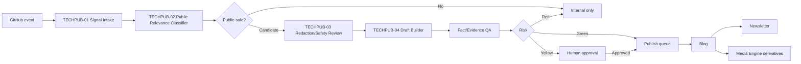

# Technical Publishing: Blog + Newsletter + GitHub

The Ginkgo/Gabriel publishing system should treat technical work as source material for durable media.

The model is inspired by the strengths of technical blogs such as AkitaOnRails: searchable archives, tagged long-form posts, RSS, links to code, opinion backed by implementation evidence, benchmark writeups and project-driven explanations. The objective is to reproduce the operating pattern, not copy another author's voice or site.

## Canonical publishing surface

The blog is the source of truth.

Recommended navigation:

```text
Home
Articles
Engineering
Research
Benchmarks
Build Logs
LiveBench
Library
Newsletter
Archive
Tags
About
GitHub
RSS
```

Required capabilities:

- full-text search;
- chronological archive;
- tags/topics;
- featured posts;
- RSS/Atom feed;
- canonical URLs;
- code blocks and diagrams;
- Mermaid support;
- GitHub source links;
- related posts;
- PT-BR / EN locale variants;
- newsletter subscription;
- metadata for OpenGraph/social cards;
- structured data for technical articles.

## Editorial families

### 1. Deep Dive

A durable technical explanation.

Examples:

- Why n8n should be an executor, not the agent brain.
- Capability Bus vs tool soup.
- Memory, RAG and context are different systems.

### 2. Build Log

Real engineering progress from a repository, release or experiment.

Structure:

```text
problem
baseline
decision
implementation
trade-offs
evidence
what failed
what changed
next step
```

### 3. Benchmark Report

A reproducible result sourced from Ginkgo LiveBench.

Must include:

- benchmark version;
- date/time;
- provider/model version;
- dataset/eval definition;
- hardware/runtime where relevant;
- repetitions/sample size;
- scoring method;
- cost and latency;
- known limitations;
- reproducibility artifacts where public-safe.

### 4. Engineering Opinion

Strong thesis with receipts.

Required:

- explicit distinction between fact and opinion;
- evidence/source links;
- real implementation context when available;
- counterargument section for consequential claims.

### 5. Release / Changelog

Product and infrastructure changes translated from release evidence into user-facing technical communication.

### 6. Research Note

Shorter analysis of papers, models, infrastructure changes or market developments connected to actual Ginkgo work.

## GitHub -> publication pipeline

GitHub is a primary technical source, but private repositories are **private by default**.



## Eligible GitHub signals

Potential publication triggers:

- public release published;
- PR merged with `publishable` metadata;
- benchmark results completed;
- architecture decision explicitly marked public-safe;
- public repository milestone;
- open-source component released;
- technical incident/postmortem explicitly approved for disclosure;
- meaningful performance improvement with evidence.

Never infer that a private repo change is publishable merely because it is technically interesting.

## Public-safety gate

Default:

```text
private_repo -> NOT_PUBLISHABLE
```

Publication requires one of:

- source repository is public and artifact is safe;
- explicit `public_safe=true` metadata;
- manual approval through the publishing gateway.

The gate must search for and block:

- credentials/secrets;
- customer data;
- internal URLs/IPs;
- private names/identifiers;
- unpublished commercial information;
- security-sensitive architecture details;
- proprietary prompts/configuration not intended for release;
- incident details that increase exploitation risk.

## Newsletter strategy

The newsletter should not be a second content team.

It is generated from the week's canonical technical graph.

Recommended weekly structure:

```text
1. Opening thesis from Gabriel
2. What we built
3. One technical deep dive
4. LiveBench movement
5. One useful tool/repository/resource
6. Ginkgo release / experiment
7. What we are testing next
```

Two variants can share the same source graph:

- **Gabriel / Builder Notes** — personal, opinionated, implementation-led.
- **Ginkgo / Engineering Dispatch** — institutional, concise, product/research-led.

A single newsletter may be preferable during early stage; split only when audiences are measurably distinct.

## Newsletter distribution

Canonical email is owned audience.

Secondary syndication may include:

- LinkedIn newsletter/article;
- blog RSS;
- X thread;
- Threads summary;
- YouTube community post;
- Instagram carousel/reel derived from the strongest idea.

Do not make LinkedIn the only newsletter archive.

## Technical content graph

Each article should be connected to its source evidence.

```text
article_id
canonical_idea_id
source_refs[]
github_refs[]
benchmark_refs[]
claim_refs[]
related_articles[]
locale
published_at
revision
```

This permits automatic updates when a benchmark or implementation changes.

## Article revision policy

Technical articles are living artifacts.

When source evidence materially changes:

1. create revision candidate;
2. diff the claims impacted;
3. update benchmark/model versions;
4. preserve original publication date;
5. show `last_updated_at`;
6. keep revision history internally.

## n8n workflow family

```text
TECHPUB-01 GitHub/Product Signal Intake
TECHPUB-02 Public Relevance Classifier
TECHPUB-03 Redaction + Disclosure Gate
TECHPUB-04 Technical Draft Builder
TECHPUB-05 Evidence Linker
TECHPUB-06 Article QA
TECHPUB-07 Blog Publisher
TECHPUB-08 Newsletter Composer
TECHPUB-09 Newsletter Publisher
TECHPUB-10 Social Derivative Trigger
TECHPUB-11 Article Revision Monitor
TECHPUB-12 RSS/Search Index Refresh
```

## Quality invariant

The publishing system must optimize for **durable technical authority**, not article count.

One engineering post that remains useful for three years is worth more than thirty synthetic summaries with no original evidence.
