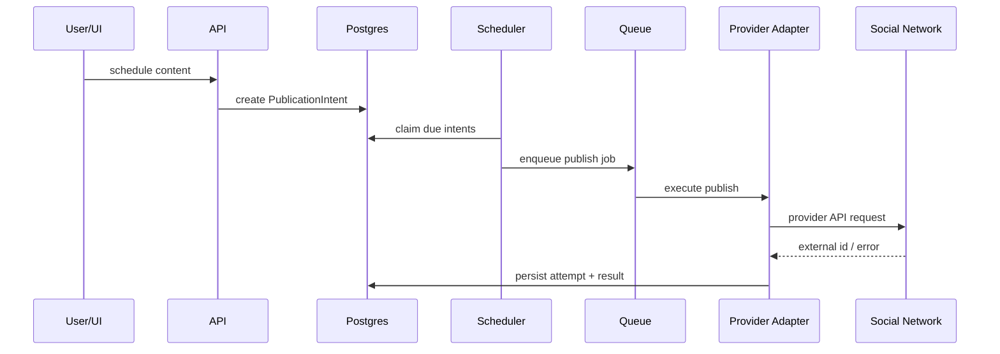
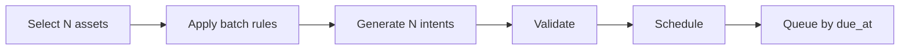

# SpeedPost Benchmark — Reverse Engineering Notes

## Objetivo

Usar a experiência observada no vídeo e as superfícies públicas do produto como **benchmark funcional**, não como especificação proprietária.

A intenção é separar:

- o que foi visualmente observado;
- o que é inferência arquitetural;
- o que deve ser validado tecnicamente antes de qualquer implementação equivalente.

## 1. O que o material demonstra

### Operação em lote

O fluxo observado é claramente otimizado para volume, não para criação artesanal de um único post.

Elementos percebidos:

- dezenas de vídeos disponíveis em uma mesma operação;
- edição/processamento em lote;
- calendário recorrente;
- múltiplos horários por dia;
- lote grande de posts agendados;
- gestão de estados de publicação;
- transformação de copy;
- distribuição para redes sociais.

Em uma tela foi possível observar uma operação com aproximadamente 150 posts agendados para uma conta, o que reforça a hipótese de que o principal valor do produto é reduzir custo operacional por publicação.

## 2. Superfícies de produto relevantes

### Calendar

Funções benchmark:

- slots de publicação;
- recorrência semanal;
- visão de calendário;
- estado por conteúdo;
- reagendamento;
- cancelamento;
- operação em massa.

### Caption transformation

Funções benchmark observadas:

- melhoria de texto;
- resumo;
- expansão;
- emojis;
- hashtags;
- variações de palavras.

Para Pyre, isso deve virar um pipeline de copy com contexto de canal, brand voice e objetivo de conversão — não apenas um conjunto de botões de transformação.

### Distribution

O produto demonstra o padrão clássico:

```text
asset -> caption -> schedule -> queue -> publish -> state
```

Pyre deve ampliar para:

```text
hypothesis
  -> content variant
  -> media asset
  -> publication intent
  -> platform attempt
  -> metrics
  -> optimization decision
```

## 3. Estados observados como referência

Os rótulos vistos no fluxo incluem estados equivalentes a:

- Agendado
- Pendente
- Na fila
- Processando
- Publicado
- Parcial

### Normalização proposta no Pyre

| UI / conceito | Estado canônico Pyre |
|---|---|
| Rascunho | `DRAFT` |
| Pronto | `READY` |
| Agendado | `SCHEDULED` |
| Na fila | `QUEUED` |
| Processando | `PROCESSING` |
| Publicado | `PUBLISHED` |
| Parcial | `PARTIAL` |
| Falha recuperável | `FAILED_RETRYABLE` |
| Falha definitiva | `FAILED_FINAL` |
| Cancelado | `CANCELLED` |

## 4. O que copiar conceitualmente

### 4.1 UX de massa

A maior lição não é uma API específica. É a redução de cliques por lote.

Princípio:

> Operações repetidas devem ser representadas como regras, não como cliques.

Exemplos:

- 5 horários/dia viram uma política de slots;
- 150 posts viram um lote;
- captions semelhantes viram template + variáveis;
- publicação multi-rede vira um intent com destinos;
- falhas viram retries automáticos governados por política.

### 4.2 Calendário como superfície operacional

O calendário não deve ser apenas visualização. Deve ser uma projeção do scheduler.

No Pyre:

```text
Calendar View
     ↓
PublicationIntents
     ↓
Scheduler
     ↓
Queues
     ↓
Provider adapters
```

A UI lê a mesma fonte de verdade usada pelo executor.

### 4.3 Estado explícito

Toda publicação precisa de estado legível e auditável.

Evitar:

```text
"o job sumiu"
```

Preferir:

```text
QUEUED -> PROCESSING -> FAILED_RETRYABLE -> QUEUED -> PUBLISHED
```

com timestamps, attempts e reason codes.

## 5. O que NÃO copiar

### Monólito de provider

Não acoplar lógica diretamente a Meta/TikTok/YouTube.

### IA superficial como feature isolada

“Melhorar legenda” é útil, mas facilmente comoditizável. O diferencial deve vir de IA com memória do workspace, histórico de performance, brand voice e objetivo.

### Analytics como pós-scriptum

Se métricas entram apenas depois que o produto está pronto, o sistema nunca vira autônomo de verdade.

### Automação sem políticas

Escala sem limites cria risco operacional. Frequência, contas, horários, orçamento e mudanças de identidade devem ser governados por policies.

## 6. Engenharia reversa funcional

### Fluxo provável de scheduler

Inferência arquitetural — não observação direta do backend:



### Fluxo de batch



## 7. Benchmarks internos para Pyre

O objetivo é superar o benchmark em profundidade operacional.

### Tempo operacional

- criar 30 intents em menos de 2 minutos via UI;
- importar lote sem bloquear interface;
- reagendar lote inteiro por regra;
- mostrar falhas sem exigir busca manual em logs.

### Confiabilidade

- idempotência em publicação;
- retries configuráveis;
- dead-letter queue;
- reconciliação com provider;
- audit trail completo.

### Inteligência

- explicar por que uma variante foi criada;
- relacionar variante a hipótese;
- relacionar resultado a decisão seguinte;
- impedir otimizações fora da política.

## 8. Gap analysis

| Área | Benchmark observado | Pyre alvo |
|---|---|---|
| Scheduling | forte | forte + policy-driven |
| Batch operations | forte | forte |
| Caption AI | utilitária | contextual + performance-aware |
| Media workflow | lote | fábrica versionada |
| Analytics | não central no vídeo | núcleo do loop |
| Experimentation | não evidente | first-class entity |
| Autonomy | parcial | bounded autonomy |
| Evidence | não evidente | obrigatória |
| Provider abstraction | desconhecida | obrigatória |
| Agent interoperability | não evidente | caller-agnostic |

## 9. Questões para validação futura

Antes de usar qualquer concorrente como referência técnica mais profunda, validar por meios legítimos e públicos:

- canais suportados atualmente;
- limites de lote;
- limites de upload;
- estratégia de retries;
- comportamento de publicação parcial;
- modelo de cobrança;
- limites por workspace/conta;
- suporte a first comment;
- gestão de permissões;
- webhooks ou polling para reconciliação;
- métricas retornadas por plataforma.

## 10. Conclusão

O benchmark prova uma tese simples: **social publishing em escala exige UX de lote, scheduler confiável e estados explícitos**.

O Pyre deve preservar essa ergonomia, mas construir o moat em outra camada:

```text
CONTENT OPERATIONS
       +
EXPERIMENTATION
       +
AGENTIC OPTIMIZATION
       =
PYRE
```

A referência ajuda a desenhar a esteira. O diferencial Ginkgo deve ser o cérebro que decide como a esteira se adapta.