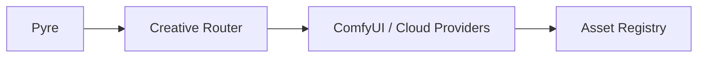

# Local Media Lab — landing zone

> Preservado na **WAVE 2** (2026-08-17) a partir do antigo laboratório local `C:\dev\pyre`
> (repo git local sem remote, HEAD `d937c69`). Esta pasta é uma **landing zone**: o conteúdo
> entra aqui na forma original para refatoração posterior — não é a estrutura final.

## Origem

Laboratório local de geração de mídia com ComfyUI, desenvolvido fora do GitHub. O histórico git
local não é relacionado ao deste repositório; os arquivos foram importados por transplante
(working tree), preservando as edições locais não commitadas. O README original do lab está em
[`README-lab.md`](./README-lab.md).

## Propósito

Gerar retratos e mídia com **identidade visual consistente** para a personagem virtual
(`characters/virtual_creator_v01.md`), via Comfy Cloud API e workflows ComfyUI versionados,
com validação automatizada e log de gerações.

## Arquitetura

- `api/submit_comfy_cloud.py` — cliente Python (stdlib-only) do Comfy Cloud: validação de nodes,
  dry-run e submissão de workflows.
- `workflows/` — workflows ComfyUI versionados (identity; categorias campaigns/carousel/
  lifestyle/video reservadas).
- `prompts/`, `characters/` — blocos de prompt e definição da personagem.
- `docs/00..06` — decisões de plataforma, fases, API e checkpoints de validação.
- `scripts/validate.ps1` + `tests/` — runner de validação (unittest + validação dos JSONs).
- `outputs/` — convenção de logs de geração (`generation_log.example.json`); mídia real fica fora do Git.

## Dependências externas (fora deste repositório)

- **ComfyUI** — será **runtime compartilhado do ai-stack** (Ginkgo-Core/ai-stack); não é
  vendorizado aqui. Versões pinadas registradas em `C:\AI\60-Tools\comfyui-runtime-manifest\`.
- **MuseTalk** — **dependency/provider externo** (TMElyralab/MuseTalk, pin em
  `C:\AI\60-Tools\musetalk-runtime-manifest\`); nunca vendorizado.
- **Comfy Cloud API** — credenciais somente via `.env` local (ver `.env.example`).

## O que fica fora do Git

- Model weights (checkpoints, LoRA, VAE etc.) → assets locais (`C:\AI\30-Assets\models\`).
- Mídia gerada (`outputs/generated/`) → assets locais (`C:\AI\30-Assets\images|video|audio`).
- `.env` e qualquer credencial (ver `.gitignore` desta pasta).

## Status

Landing zone estável para leitura; a integração com o produto (Creative Router / Asset
Registry) é refatoração futura, decidida fora desta pasta.
