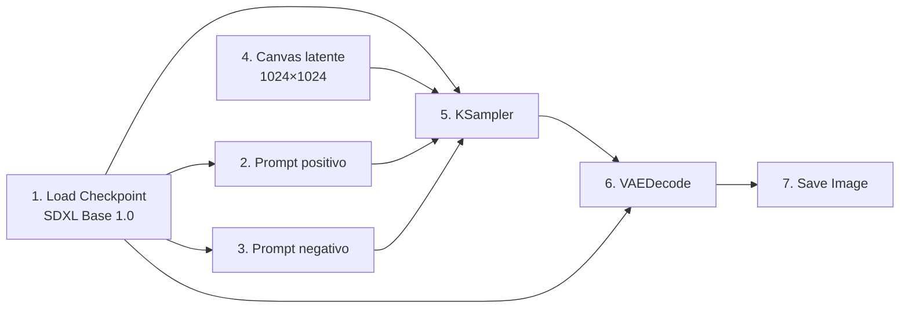

# Workflow inicial: retrato consistente v01

## Objetivo realista

Este workflow cria um retrato **reproduzível** de uma pessoa fictícia adulta usando prompt, checkpoint e seed fixos. Ele é o começo da consistência, não a consistência perfeita entre poses e cenários. Sem uma referência autorizada ou LoRA, mudanças grandes de ângulo, roupa ou ambiente podem alterar o rosto.

Há duas versões do mesmo grafo:

- `portrait_consistent_manual_v01.json`: abre no canvas do ComfyUI para aprendizagem e execução manual.
- `portrait_consistent_api_v01.json`: formato enxuto de nodes/inputs aceito pela API; é usado por `api/submit_comfy_cloud.py`.

## Mapa visual

## Passo a passo didático

| Etapa | O que fazer | Por que | Como testar | Resultado esperado | Como desfazer |
| --- | --- | --- | --- | --- | --- |
| 1. Carregar | Importe o JSON manual no Comfy Cloud. | Mostra o grafo inteiro, sem precisar montar conexões. | Todos os sete nodes aparecem e não há nodes vermelhos. | Canvas com as sete caixas ligadas. | Feche sem salvar ou importe novamente o arquivo v01. |
| 2. Confirmar modelo | No node 1, selecione o checkpoint SDXL compatível disponível na conta. | Checkpoint, CLIP e VAE precisam pertencer ao mesmo pacote base. | O seletor não mostra erro de arquivo inexistente. | O node produz as três saídas: MODEL, CLIP e VAE. | Restaure o nome registrado no JSON ou reimporte v01. |
| 3. Preservar identidade | Leia o texto do node 2. Não mude os traços âncora durante a escolha da personagem. | O texto define a primeira identidade antes de existir uma referência visual. | Compare o texto com `prompts/identity_base_v01.md`. | Características repetidas em cada execução com mesma seed. | Reimporte v01; para uma alteração aprovada, crie v02 em vez de sobrescrever. |
| 4. Evitar defeitos | Mantenha o prompt negativo do node 3. | Ele reduz artefatos e bloqueia aparência de menor de idade. | Compare com `prompts/negative_portrait_v01.md`. | Menos texto, marcas d’água e deformações. | Reimporte v01. |
| 5. Gerar | No node 5, mantenha seed `2407202601`, 28 steps, CFG 6, sampler Euler e denoise 1. Clique em executar. | Seed fixa permite repetir a mesma configuração. Os valores são um ponto de partida econômico, não uma lei. | Execute duas vezes sem alterar nada. | Duas imagens equivalentes no mesmo ambiente/modelo. | Volte aos valores acima ou reimporte v01. |
| 6. Avaliar saída | Abra a imagem do node 7; registre seed, checkpoint e prompt se ela for candidata. | Sem registro não há como reproduzir ou comparar a identidade. | Use a lista em `05-checkpoints-de-validacao.md`. | Uma decisão objetiva: aprovar, rejeitar ou ajustar uma variável. | A imagem pode ser removida da galeria; o JSON original continua intacto. |

## O que cada node faz

1. **CheckpointLoaderSimple** carrega três componentes de um checkpoint: o modelo de difusão, o interpretador de texto (CLIP) e o decodificador (VAE).
2. **CLIPTextEncode (positivo)** transforma a descrição desejada em instruções para o modelo.
3. **CLIPTextEncode (negativo)** descreve o que deve ser evitado.
4. **EmptyLatentImage** cria o “rascunho invisível” no tamanho 1024×1024.
5. **KSampler** parte de ruído e segue as instruções até formar uma imagem latente. A seed define o ponto de partida desse ruído.
6. **VAEDecode** transforma a imagem latente em pixels visíveis.
7. **SaveImage** grava/mostra o resultado.

## Limites e mudanças permitidas

Na seleção inicial, mude **somente a seed**, uma vez por imagem. Depois de aprovar uma candidata, congele seed, checkpoint, prompt e parâmetros. Para o próximo teste, mude uma variável por vez e salve um novo arquivo com versão maior.

Não acrescente ControlNet, IP-Adapter, face swap ou LoRA nesta fase. Eles exigem modelos/adaptadores adicionais e uma decisão explícita de direitos, compatibilidade e custo.
